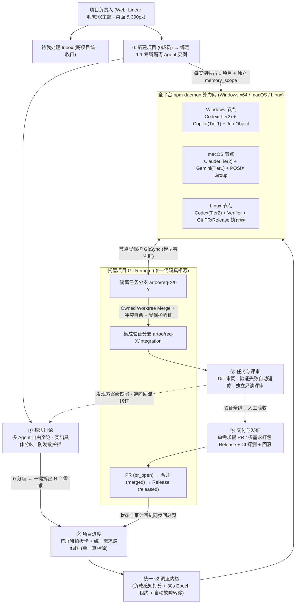

# Artoo 端到端闭环设计与实现总纲（最终定版）

> **代码基线**：`origin/main` 最新提交 `4f7278b`  
> **配套定稿 UI 原型**：[artoo-linear-final.html](prototypes/artoo-linear-final.html)（Linear 风格 · 明/暗双主题 · 桌面 1280px & 窄屏 390px 响应式）

---

## 一、已锁定的 8 项核心产品与架构决策

经过全仓四端源码审计与多轮原型验证，本方案锁定以下 **8 项不可动摇的产品与技术边界**：

1. **算力端形态聚焦 `npm-daemon`**：冻结 `apps/desktop`（Electron 壳暂不投入），全部工程资源集中于 **Web 端 + Server 端 + 全平台 `npm-daemon`（`@jiayunxie/artood`：Windows x64 / macOS / Linux）**。
2. **建项后再组队 + 严格「1 Agent Instance = 1 Project」隔离**：新建项目默认 `0` 成员，随后为该项目连接专属隔离的 Agent 实例。**同一个 Agent Instance 严格独占 1 个项目**，拥有独立 `memory_scope` 与独立本地工作区目录，杜绝跨项目记忆与上下文污染（同台电脑可通过「派生全新隔离实例」安全复用算力与 CLI）。
3. **起点是「模糊想法」，由团队自由讨论拆成多个需求**：用户无需上来就手写精细工单；在 **`① 想法讨论`** 抛出最初想法 → 多 Agent 自由辩论、提出分歧 → **彻底去掉虚构的“共识百分比”**，直接展示**具体未决分歧 + 「参与决定」** → 确认后一键将拆出的多个需求写入统一项目进度；执行或评审遇方案级问题时支持**一键拉回讨论室修订**。
4. **一个项目 = 一套扁平统一的 4 步工作台**：取消按需求重复嵌套 4 大 Tab，统一为 **`① 想法讨论 › ② 项目进度 › ③ 任务评审 › ④ 交付发布`**；`② 项目进度` 首屏优先回答 **“团队现在在等我做什么”**（置顶具体待拍板问题 + 影响需求编号），待验收排第二，普通讨论归入动态，不重复堆叠总百分比。
5. **首版聚焦托管项目 Git Remote，同时在契约层保留多来源/多 VCS 扩展性**：首版先完整跑通 **托管 Git Remote（GitHub / GitLab / Gitea / 自建裸仓库）+ Per-Run Worktree + 节点受保护 `GitSyncAdapter`**（凭据绝不暴露给模型，仅允许推送 `refs/heads/artoo/*`），停止继续扩写复杂的 H2–H9 单跳 JSON 胶囊状态机；同时在 Domain/Protocol/DB/Artood 中抽象 **`WorkspaceSource` + `VersionRef` + `WorkspaceSyncAdapter` + `DeliveryExecutor`** 四层薄接口，为二期平滑接入 **纯本地文件夹（`local_folder`）** 与 **SVN / Perforce / Mercurial（`vcs_plugin`）** 留足零返工扩展口子（未启用的来源类型严格 fail-closed）。
6. **状态单一真相源 + 诚实交付四态**：Inbox、项目进度、任务列表、代码评审与交付页全部实时读取**同一份节点拥有验证回执**，单测失败即全网同步标红并由服务端锁死验收接口；交付状态严格区分 **`已验收待提 PR` → `已提 PR (未合入)` → `已合并 main` → `已发布 Release`**，绝不把创建 PR 误标成“已交付上线”。
7. **首批交付执行器聚焦 `git_pr` / `github_release`**：支持勾选 **1 个已验收需求独立提 PR**，或勾选 **多个已验收需求打包发布版本 Release**，具备远端 CI Check Runs 探测、资产 SHA-256 校验、一键受控回滚与 `ed25519-v1` 签名审计包。
8. **Linear 明/暗双主题 + 390px 移动窄屏原生可用**：Web UI 采用 Linear 极简发丝分割与高密度列表、**14–15px 标题 / 12px 元信息层次**、内置 **Linear Dark & Linear Light 双主题切换**；390px 窄屏自动收起固定侧栏至顶部 `☰` 抽屉、默认优先看「待我处理」、讨论室切为「分歧与草案 / 讨论记录」双视图。

---

## 二、全链路 E2E 闭环架构总图



---

## 三、五大核心子系统工程规格（对齐源码模块）

### 3.1 全平台 `npm-daemon` 算力接入与常驻运维

- **跨平台解封**：
  - 修改 [scripts/npm-daemon/platforms.mjs](../scripts/npm-daemon/platforms.mjs) 与 [scripts/npm-daemon/build.mjs](../scripts/npm-daemon/build.mjs)：放开 `win32-x64`、`darwin-arm64`、`darwin-x64`、`linux-x64`。Windows 包内嵌 `.NET 10` `Artoo.WindowsProcessHost.exe`；POSIX 包复用 `apps/artood` 既有的进程组隔离与 `parent-guard.ts`。
  - 修改 [ConnectNodeDialog.tsx](../apps/web/src/components/ConnectNodeDialog.tsx) 与 [SettingsPage.tsx](../apps/web/src/components/SettingsPage.tsx)：支持三平台命令生成，daemon 版本由服务端 `bootstrap` 动态下发。
- **常驻服务与一键自检**：
  - [scripts/npm-daemon/cli.mjs](../scripts/npm-daemon/cli.mjs) 新增：
    - `artood service install / uninstall / status`（Windows 用户级 Task Scheduler / macOS `launchd` / Linux `systemd --user`）；
    - `artood doctor`（自检 Node/Git、CLI 指纹、NTFS/POSIX 私有目录权限、Git Remote 连通性、验证 Profile 完整性）；
    - `artood init-private-dirs`（显式确认后创建合格私有 `temporary_directory` 与 `codex.home_directory`）。
  - [apps/artood/src/heartbeat.ts](../apps/artood/src/heartbeat.ts)：接入真实 CPU、内存、工作区磁盘余量采样；`node.hello` 上报只读 `verification_profiles[]` 与 `git_remote_profiles[]` 元数据摘要（绝不暴露密钥或敏感绝对路径）。

---

### 3.2 「1 Agent Instance = 1 Project」专属实例隔离与多 CLI 分级池

- **数据库与服务端强约束（追加迁移 `0080_instance_isolation_and_ideas.sql`）**：
  - 扩展 `agent_instances`：新增 `memory_scope TEXT NOT NULL`（按 `project_id + instance_id` 强制隔离），新增服务层与事务级校验：**已绑定到 `project A` 的实例禁止被 `project B` 的 Squad/Task 引用（返回 `409 INSTANCE_PROJECT_EXCLUSIVE`）**；只有 `project_id IS NULL` 的空闲实例可被独占认领；释放实例时显式标记/归档旧 `memory_scope`，避免残余记忆带入下一个项目。
  - 新增 API：
    - `POST /api/v1/projects/:id/team/provision`：按角色模板一键在在线电脑上为该项目批量派生全新隔离实例（含自动生成独立 `workspace_root` 子目录与 `memory_scope`）；
    - `POST /api/v1/projects/:id/team/clone-instance`：复用指定在线电脑与 CLI 配置，但派生**全新 `agent_instance_id` + 独立记忆域**绑定给当前项目；
    - `POST /api/v1/agent-instances/:id/claim` & `POST /api/v1/agent-instances/:id/release`：独占认领空闲实例 / 释放并重置记忆域。
- **3 级多 CLI 能力模型**：
  - 协议 [packages/protocol/src/cli-discovery.ts](../packages/protocol/src/cli-discovery.ts) 新增可选 `runtime_tier`：
    - **Tier 1 只读分析与评审**：无写/无 Shell，允许挂载冻结只读上下文与 Diff。率先解除 [apps/artood/src/main.ts](../apps/artood/src/main.ts#L529-L530) 中 Managed Journal 与 `copilot` 单轮适配器的互斥，开放 `copilot` 参与项目想法讨论与独立 Diff 评审；按 T17 隔离探针标准依次推进 `gemini`、`opencode`、`cursor` 与 **Direct Model API Adapter**。
    - **Tier 2 受控工作区读写**：`codex`、`claude-code` 运行于独立 Per-Run Worktree。
    - **Tier 3 受保护执行器**：验证器、Git Sync、`git_pr` / `github_release` 发布器。
  - 任何 CLI 认证失效（如 Copilot 过期）由节点精确上报 `auth_failed`，在「算力与实例」给出本机登录指引并拦截派单。

---

### 3.3 「想法自由讨论（分歧驱动）→ 拆解多需求 → 逆向回流」闭环引擎

- **数据模型（追加迁移 `0080_instance_isolation_and_ideas.sql`）**：
  - `project_ideas`：`id`, `project_id`, `title`, `prompt`, `status` (`discussing` | `ready_to_split` | `materialized`), `discussion_mode` (`auto` | `step`), `current_round`, `max_rounds`, `proposal_summary`, `split_draft_json`, `revision`。
  - `idea_disagreements`：`id`, `idea_id`, `question`, `positions_summary`, `options_json`, `status` (`open` | `resolved`), `resolution_text`, `resolved_by_user_id`, `resolved_at`。
  - `project_requirements`：`id`, `project_id`, `source_idea_id`, `code`（如 `PAY-101`）, `title`, `priority`, `owner_role`, `stage`（`planned` | `dev` | `review` | `ready_to_ship` | `pr_open` | `merged` | `released`）, `latest_verification_id`, `delivery_ref`。
  - `tasks` 新增可选外键 `requirement_id REFERENCES project_requirements(id)`（保持对旧手工任务与旧 Goal 的完全兼容）。
- **核心服务端规则**：
  - **禁止虚构共识百分比**：讨论状态只输出真实可核验事实——`current_round / max_rounds`、`open_disagreements[]`、`draft_requirements_count`。
  - **防发散护栏**：支持 `auto`（自主推进直到 0 未决分歧或触达 `max_rounds` 自动暂停）与 `step`（逐轮确认），提供 `POST /api/v1/ideas/:id/pause` 与 `POST /api/v1/ideas/:id/converge`（强制架构师汇总当前最佳草案并收口）。
  - **人工「参与决定」**：`POST /api/v1/ideas/:id/disagreements/:disId/resolve` 持久化负责人拍板结论并注入讨论上下文；当用户随时插话（`POST /api/v1/ideas/:id/messages`）时，路由给相关专属 Agent 实时修正右侧拆解草案。
  - **一键物化拆解**：`POST /api/v1/ideas/:id/materialize` 在单个数据库事务内幂等地创建勾选的 `project_requirements` 与对应 `tasks` DAG，并将首波无依赖任务入队统一调度器。
  - **逆向回流**：`POST /api/v1/tasks/:id/escalate-to-idea` 与 `POST /api/v1/requirements/:id/escalate-to-idea` 将执行阻塞或代码评审暴露的设计缺陷直接生成修订议题并跳转回 `① 想法讨论`。

---

### 3.4 统一 v2 调度 + 托管 Git Remote + 单一真相源验证与自动返修

- **消除调度脑裂 & 负载感知**：
  - 改造 [scheduler-start-proposal-service.ts](../apps/server/src/services/scheduler-start-proposal-service.ts#L52)，允许携带 `verificationRequirement` 与 `ownedResultAssignment` 的任务走 v2 Pull 调度管线（30s Epoch 租约 + 超时安全故障转移 + 陈旧写入拒绝）。
  - 解除 [goal-automation-service.ts](../apps/server/src/services/goal-automation-service.ts#L152) 的单机与 `max_concurrent_runs: 1` 硬锁；[scheduler-ranking.ts](../packages/domain/src/scheduler-ranking.ts) 引入空闲槽位、CPU/内存余量与本地仓库亲和度综合打分。
  - [collaboration-service.ts](../apps/server/src/services/collaboration-service.ts) 的 `blockers` 真正挂起下游任务并推送到「待我处理 Inbox」，解决后自动唤醒。
- **托管项目 Git Remote 跨机代码流转与多来源扩展契约（追加迁移 `0081_workspace_sources_and_version_handoffs.sql`）**：
  - **零返工扩展抽象（`packages/domain/src/workspace-source.ts` & `apps/artood/src/sync/`）**：核心调度、讨论室、验证回执、独立评审与 Inbox **绝不硬编码 GitHub 字段**，统一面向以下 4 个薄接口编程（**v1 仅落地 `git_remote` 实现，`local_folder` 与 `vcs_plugin` 保留类型契约并严格 fail-closed**）：
    ```ts
    // 1. 项目工作区来源（可辨识联合体，DB 以 JSONB workspace_source_json 存储）
    type WorkspaceSourceV1 =
      | { version: 1; kind: "git_remote"; url: string; default_branch: string; provider?: "github" | "gitlab" | "gitea" | "generic" }
      | { version: 1; kind: "local_folder"; root_path: string; sync_mode: "single_node" | "server_snapshot" } // 预留扩展，v1 fail-closed
      | { version: 1; kind: "vcs_plugin"; vcs: "svn" | "perforce" | "hg"; endpoint: string };                 // 预留扩展，v1 fail-closed

    // 2. 不可变版本引用（替代硬编码 commit_sha 字符串，统一绑定验证与交接）
    type VersionRefV1 =
      | { kind: "git_commit"; sha: string; ref?: string; tree_sha?: string }
      | { kind: "snapshot_digest"; digest: string }              // 供后续 local_folder 使用
      | { kind: "vcs_revision"; vcs: string; revision: string }; // 供后续 SVN/P4 使用

    // 3. 节点侧受保护同步适配器（模型永不接触底层凭据）
    interface WorkspaceSyncAdapter {
      readonly kind: WorkspaceSourceV1["kind"];
      prepareIsolatedWorkspace(source, baseVersion, runId): Promise<PreparedWorkspace>;
      sealAndPublishChange(workspace, runClosureProof): Promise<{ version: VersionRefV1; manifestDigest: string }>;
      mergeVersions(source, baseVersion, inputs: VersionRefV1[]): Promise<MergeOutcome>;
      generateDiff(baseVersion, targetVersion): Promise<StructuredDiff>;
    }
    ```
  - **v1 首版具体实现（`GitSyncAdapter` + `owned/worktree-results.ts`）**：
    - 为 [apps/artood/src/owned/worktree-results.ts](../apps/artood/src/owned/worktree-results.ts) 补齐基于原 OS 进程确认的安全 `stale-lease` 崩溃恢复，并正式接入主研发与评审流；
    - 实现节点受保护 `apps/artood/src/sync/git-sync-adapter.ts`：凭据（`env_token` / 受限 `ssh_key_file` / OS Credential Helper）仅存在于节点本地 `team-config.json`，**永不注入模型子进程环境**；Author 进程树真实闭合 → Owned Git 封存不可变 `VersionRef(git_commit)` → 仅允许推送至 `refs/heads/artoo/*` 隔离分支；
    - 下游并行节点 / 集成验证节点 / 独立评审节点按精确 `VersionRef` + `manifest_digest` 执行受保护 `fetch` 与隔离 Worktree Checkout；合并产生冲突时由 Owned Merge 持久化结构化冲突记录并自动派发有界冲突修复任务。
- **验证状态单一真相源（SSOT）**：
  - `GET /api/v1/inbox`、`GET /api/v1/projects/:id/control-view`、`GET /api/v1/projects/:id/requirements` 与评审页全部从**同一张最新验证回执投影**读取 `verification: { state, passed, total, last_run_at, repair_attempt, failing_log_excerpt }`。
  - 服务端硬门禁：当 `verification.state !== "passed"` 时，`POST /api/v1/requirements/:id/accept` 返回 `409 VERIFICATION_NOT_PASSED`；支持按项目配置上限（默认 3 轮）触发有界自动返修（`POST /api/v1/requirements/:id/auto-repair`）。

---

### 3.5 `git_pr` / `github_release` 四态诚实交付 + Linear 双主题响应式 Web

- **诚实交付状态机与可插拔 `DeliveryExecutor`（追加迁移 `0082_delivery_executors.sql`）**：
  - 在 `apps/artood/src/release/` 抽象统一 `DeliveryExecutor`（输入统一为已验收的 `VersionRefV1[]` + 验证回执摘要；**v1 落地 `git_pr` 与 `github_release`**，二期无需改动主流程即可插拔 `local_folder_apply` / `archive_bundle` / `gitlab_mr` / `svn_patch` / `container_deploy`）：
    - **`git_pr` 执行器**：校验所有勾选需求的验收记录与最新验证回执 → 推送合并后的隔离发布分支 → 幂等创建/更新 GitHub Pull Request（正文自动附需求清单、测试通过数、独立评审结论、审计摘要）→ **状态推进为 `pr_open`（已提 PR）** → 轮询 GitHub Check Runs 上报 CI 状态 → 仅当远端 PR 实际合并至 `default_branch` 后（通过 Webhook 或节点状态轮询核实合并 Commit SHA）才推进为 **`merged`（已合并 main）**！
    - **`github_release` 执行器**：在只读 Checkout 校验构建产物并生成 `SHA256SUMS.txt` → 打不可变 Tag → 创建 GitHub Release 并回查资产字节摘要 → 状态推进为 **`released`（已发布 Release）**。
    - **受控回滚**：`POST /api/v1/projects/:id/releases/:releaseId/rollback` 将未合入 PR 关闭并打 `artoo:rolled-back` 标签（将对应需求退回 `ready_to_ship`），或将问题 Release 标为 prerelease/撤回最新标记，全程写入不可变回滚回执。
  - **节点权限前置探测**：若当前没有任何在线节点配置了该仓库的 PR/Release 推送权限，服务端与 `④ 交付发布` 明确提示缺失节点及修复入口，拦截无效触发。
- **Linear 明/暗双主题 & 390px 响应式前端落地（`apps/web`）**：
  - 样式系统：在 `apps/web/src/styles/theme-tokens.css` 落地 `data-theme="dark"` 与 `data-theme="light"` 完整 Linear 语义 Token（默认跟随系统偏好，顶栏提供即时 **`暗 | 明`** 切换 + `T` 快捷键 + `localStorage` 持久化），发丝分割替代厚重嵌套卡片，需求标题 `14px`、首屏待拍板问题 `15px`、元信息 `12px`。
  - 响应式断点（`< 1024px` 含 `390px` 手机）：隐藏固定侧栏转为顶部 `☰` 抽屉菜单；移动端默认落点「待我处理 Inbox」；`① 想法讨论` 在窄屏自动切换为「分歧与草案 / 讨论记录」双视图，彻底杜绝横向溢出与一字一行挤压。

---

## 四、分阶段实施路线图与 15 个工程任务包（WP-01 ~ WP-15）

| 阶段 | 任务包 | 归属端 | 核心交付与精确落点 |
| :--- | :--- | :--- | :--- |
| **Phase 0**<br/>现网止血与基线全绿<br/>(第 1–2 周) | **WP-01** | Web / Artood | 修复 [Nav.tsx](../apps/web/src/components/Nav.tsx#L120-L124) 误触退出项目问题、统一中英文文案、解除 [apps/artood/src/main.ts](../apps/artood/src/main.ts#L529-L530) Managed Journal 与 Copilot 单轮互斥 |
| | **WP-02** | 全栈基线 | 冻结旧 H2–H9 不再扩写；在最新 `main` 跑通同一 SHA 的 `typecheck` + `build` + `npm test -- --maxWorkers=2` + Web E2E 全绿基线 |
| **Phase 1**<br/>全平台算力与专属实例隔离<br/>(第 3–4 周) | **WP-03** | Artood / Web | `scripts/npm-daemon/platforms.mjs` & `build.mjs` 放开 `win32-x64` / `darwin-*` / `linux-x64`；Web `ConnectNodeDialog` 支持三 OS 与动态版本下发 |
| | **WP-04** | Artood | `cli.mjs` 新增 `artood service install/uninstall/status`、`artood doctor`、`artood init-private-dirs`、轮转日志与 `heartbeat.ts` 真实 CPU/内存/磁盘采样 |
| | **WP-05** | DB / Server / Web | 迁移 `0080` 第一部分：落地 **1 Agent Instance = 1 Project** 强约束与 `memory_scope` 隔离；实现 `provision` / `clone-instance` / `claim` / `release` 接口与建项后空团队引导页 |
| **Phase 2**<br/>想法讨论拆需求与多 CLI 统一调度<br/>(第 5–7 周) | **WP-06** | DB / Server | 迁移 `0080` 第二部分：落地 `project_ideas`、`idea_disagreements`、`project_requirements`、`tasks.requirement_id`；实现自由讨论护栏、分歧拍板、一键事务物化拆解与执行/评审逆向回流 API |
| | **WP-07** | Protocol / Artood | 扩展 `runtime_tier`（Tier 1 只读分析评审 / Tier 2 读写 / Tier 3 执行器）；开放 Copilot 挂载只读上下文参与讨论与 Diff 评审；推进 `gemini` / `opencode` / `cursor` 隔离资格验证与 Direct Model API Adapter |
| | **WP-08** | Server / Domain | 改造 `scheduler-start-proposal-service.ts` 支持验证/Owned 任务收敛 v1/v2 调度；`scheduler-ranking.ts` 引入负载打分；解除单机与 `max_concurrent_runs: 1` 硬锁；`blockers` 真正挂起/唤醒调度 |
| **Phase 3**<br/>托管 Git 跨机开发、SSOT 验证与 Linear UI<br/>(第 8–10 周) | **WP-09** | Artood / Domain | 在 `packages/domain` 落 `WorkspaceSourceV1` / `VersionRefV1` 契约（预留 `local_folder` / `vcs_plugin` 严格 fail-closed）；为 `owned/worktree-results.ts` 补齐安全 `stale-lease` 恢复；实现 `sync/git-sync-adapter.ts`（仅推 `refs/heads/artoo/*`）；完成 Windows Scheduler Journal 实测 |
| | **WP-10** | DB / Server | 迁移 `0081_workspace_sources_and_version_handoffs.sql`；将跨机并行开发、Owned Merge 冲突自愈、独立评审接入 `VersionRef` + Git Remote；实现**单一真相源验证投影**、`GET /api/v1/inbox` 与有界自动返修 API |
| | **WP-11** | Web | 按 [artoo-linear-final.html](prototypes/artoo-linear-final.html) 落地 Linear 极简风格 + **Dark/Light 双主题** + **390px 抽屉与双视图响应式**；实现首屏待拍板卡、分歧驱动讨论室、Git Diff 审阅、任务紧急停止与增量游标同步 |
| **Phase 4**<br/>`git_pr` / `github_release` 交付与 E2E 总验<br/>(第 11–12 周) | **WP-12** | Protocol / DB / Artood | 迁移 `0082_delivery_executors.sql`；抽象可插拔 `DeliveryExecutor` 接口，首版实现 `git_pr`（推分支、幂等建/更 PR、CI Check Runs 探测、合入确认、关闭回滚）与 `github_release`（资产 SHA-256、打 Tag、发 Release、撤回回滚） |
| | **WP-13** | Server / Web | 实现多需求打包交付 API（`POST /api/v1/projects/:id/releases` & `/rollback`）、在线节点 PR 权限门禁与诚实四态推进（`ready_to_ship → pr_open → merged → released`）；升级 `④ 交付发布` 控制台 |
| | **WP-14** | Web / Server E2E | 编写并跑通全套 12 项 Playwright + 受控多节点自动化 E2E 套件（桌面 1280px + 390px 窄屏 + Dark/Light 双主题 + 全部负例断言） |
| | **WP-15** | 真实双机验收 | 使用 2 台真实电脑（Windows + macOS/Linux）+ 真实模型账号 + 真实 GitHub 仓库跑完从“一句模糊想法”到“PR 创建 → CI 全绿 → 合入 main / 发布 Release → 审计导出”完整真机验收并留档证据 |

---

## 五、E2E 端到端闭环验收矩阵（12 条必过硬门禁）

为确保代码落地后**真正实现 E2E 全闭环、零矛盾、零死角**，验收严格分为 **受控自动化 E2E（Layer A，合入前 CI 必过）** 与 **真实双机 + 真模型 + 真实仓库 E2E（Layer B，发布前必过）**，两者分开记录、互不替代：

| 用例编号 | 验证链路 | 关键操作路径 | 强制通过断言（Hard Assertions） | 验证层级 |
| :--- | :--- | :--- | :--- | :--- |
| **E2E-01** | **全平台算力接入与自检** | Windows + macOS/Linux 分别执行 `artood connect` 与 `service install`，重启电脑后观察 Web | 双机自动重连上线；`heartbeat` 上报真实 CPU/内存/磁盘、`verification_profiles` 与 `git_remote_profiles`；`artood doctor` 返回 0 | Layer A + B |
| **E2E-02** | **建项后 1:1 专属实例隔离（含负例）** | 新建项目 → 验证默认 0 成员 → 尝试 API 直接把项目 A 的实例绑定到项目 B → 再执行“同机派生新实例”与“认领空闲实例” | 跨项目复用返回 `409 INSTANCE_PROJECT_EXCLUSIVE`；派生的新实例拥有全新 ID 与独立 `memory_scope`，项目 A 原实例绑定不变 | Layer A |
| **E2E-03** | **想法自由讨论 → 分歧拍板 → 拆解多需求** | 在 `① 想法讨论` 抛入模糊想法 → 多 Agent 讨论产出 1 条未决分歧 → 负责人点击「参与决定」拍板 → 勾选 2/3 个需求点击「确认拆解」 | 全界面**零出现**虚构“共识百分比”；拆解事务幂等创建 2 个需求及对应任务并立刻出现在 `② 项目进度` 路线图，首批任务自动入队 | Layer A + B |
| **E2E-04** | **讨论防发散护栏 & 逆向回流** | 触发轮次上限自动暂停 → 点击「强制收敛」；另在执行阻塞抽屉与评审页分别点击「拉回讨论室修订」 | 超过 `max_rounds` 自动停轮不继续烧额度；拉回操作自动创建修订议题并带上原阻塞/报错上下文，形成 `讨论 ⇄ 执行` 双向闭环 | Layer A |
| **E2E-05** | **多机并行开发 + Git Sync 零凭据泄露 + 未启用来源 fail-closed** | 2 个无依赖任务由统一 v2 调度器分别派往电脑 A 与电脑 B 在独立 Worktree 并行编码并推送隔离分支；另提交未启用的 `local_folder` / `vcs_plugin` 来源负例 | 模型子进程环境与日志中**零出现** Git Token/SSH Key；仅允许推送 `refs/heads/artoo/*`；`VersionRef(git_commit)` 精确落库；未注册适配器的来源类型严格返回 `UNSUPPORTED_WORKSPACE_SOURCE` fail-closed | Layer A + B |
| **E2E-06** | **状态单一真相源（防矛盾负例）** | 令 `REQ-02` 的受保护验证返回失败（`39/42`），依次检查 `待我处理 Inbox`、`② 项目进度`、`③ 任务列表`、`③ 代码评审` 与验收 API | 全部 4 个界面同步显示 `39/42 失败`、**绝不出现** `42/42` 或 `测试全绿`；直接调用 `POST .../accept` 被服务端返回 `409` 拒绝 | Layer A |
| **E2E-07** | **验证失败自动返修 & Git 合并冲突自愈** | 对 `39/42` 失败触发自动返修；构造 2 个并行分支修改同一行触发合并冲突 | 自动返修不超过 `max_auto_repairs` 上限并复测转绿 `42/42`；冲突被 Owned Merge 捕获并自动派单修复后重新通过受保护验证 | Layer A + B |
| **E2E-08** | **紧急停止与 OS 进程树真实闭合** | 任务流式执行中途在抽屉点击「紧急停止」 | 确认实际子进程树（Windows Job / POSIX Group）0 残留进程退出后才将状态置为 `stopped` 并释放节点槽位，随即新任务可正常复用槽位 | Layer A + B |
| **E2E-09** | **节点断网自动故障转移与陈旧写拒绝** | 任务运行中拔掉电脑 A 网络超过 30s 租约窗口，再恢复电脑 A 网络 | 调度器颁布新 Epoch 授权由电脑 B 安全接管续跑；电脑 A 恢复后携带旧 Epoch 的延迟写入与心跳被服务端严格拒绝 | Layer A + B |
| **E2E-10** | **`git_pr` 诚实四态与节点权限门禁** | 先把持有仓库 PR 权限的节点置为离线观察拦截；恢复上线后勾选 2 个已验收需求触发 `git_pr` → 观察 CI → 合并至 `main` → 另测 1 次回滚 | 无授权在线节点时拦截并提示原因；建 PR 后状态严格为 **`已提 PR`**（**绝不标为已上线**）；合并后才变 **`已合并 main`**；回滚自动关闭 PR 并退回待交付池 | Layer A + B |
| **E2E-11** | **`github_release` 不可变资产发布与审计验签** | 选择 `github_release` 发布版本包，随后导出 `ed25519-v1` 签名审计包并离线验签 | 自动生成 `SHA256SUMS.txt` 并核验上传资产字节一致；签名审计包通过离线验签，完整关联需求、Commit SHA、验证回执与发布结果 | Layer A + B |
| **E2E-12** | **Linear 明/暗双主题 + 390px 窄屏视觉门禁** | 在 Playwright 中分别以 `1280×800` 与 `390×844` 视口遍历 `dark` 与 `light` 双主题全部核心页面 | 390px 下无横向滚动溢出（`scrollWidth <= clientWidth`）、侧栏自动收进顶部抽屉、默认先看「待我处理」、讨论室切换双视图、主按钮与文字对比度达标 | Layer A |

---

## 六、不可突破的工程与安全红线（`AGENTS.md` 对齐）

> [!CAUTION]
> 1. **模型零凭据原则**：Git Token、SSH Key、GitHub PAT 与发布密钥只由 `artood` 本地受保护执行器读取，永不进入模型子进程环境、argv、ContextPack 或审计日志。
> 2. **节点拥有验证权威**：`run.verification` 永远由节点受保护 Profile 在 Author 进程真实闭合后独立产出，模型输出与任务文本不可伪造或覆盖。
> 3. **追加式演进与向后兼容**：数据库只增新序号迁移（`0080+`），绝不修改历史已发布迁移；协议只增可选版本字段，保障新旧节点灰度兼容。
> 4. **代码提交前强制检查**：每次提交前按 `AGENTS.md` 执行 `npm run check:staged`、`npm run typecheck`、`npm run build` 及对应聚焦测试与 E2E 回归。
