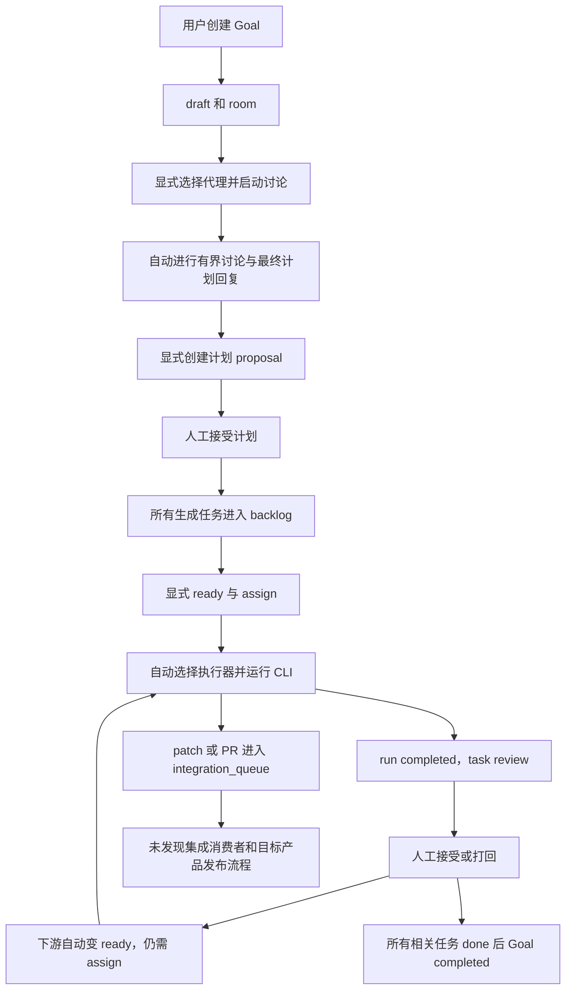

评估结论：当前 Artoo **不能完成“用户只提一次需求，随后完全不介入，系统独立完成调研、设计、实现、测试、审核、发布”的产品开发闭环**。项目已经具有可复用的多代理协作、执行、恢复与审计基础，但仍需要人工推进计划和验收，并缺少目标产品的自动集成、质量裁决和发布流程。继续在现有架构上建设是合理的，无需因此整体重写。

评估日期：2026-11-03（Asia/Shanghai）。代码基线：`6350fa39e3bef4fe3e5b0091954605df72dd4ee5`，开始检查时工作区干净。本次检查服务端、领域模型、执行器、工作区、相关测试和项目文档；没有调用真实模型或部署任何产品。下文“缺少”指在当前仓库的相关实现及调用链中未发现，不排除运营者另有外部脚本。

后续实施：该报告保留原基线结论。自主规划、任务推进、节点验收及工作区交付的第一阶段实现与限制见[实施说明](C:/workspace/artoo/docs/autonomous-development.md)，其中不包含生产发布。

用户目标需要同时满足两类条件：系统能持续推进工作，以及系统有可信依据认定工作完成。只有任务生成、CLI 能写代码或状态显示 completed，都不足以证明产品完成交付。

| 解释范围 | 当前判定 | 原因 |
| --- | --- | --- |
| 从未配置过的环境开始，用户除需求外不提供任何资源或授权 | 不支持 | 需要服务器、执行节点、CLI/provider 身份、工作区以及发布资源；外部 AI 还受已配置的数据分享政策和同意约束 |
| 基础设施和授权已配置，之后每个产品只提交一次需求 | 仍不支持完整闭环 | 计划接受、普通任务启动、审核、集成、部署仍有明确断点 |
| 限定产品类型、工具链和发布目标后，改造成日常零操作系统 | 有条件可行 | 可以复用现有底座，但需要新增目标编排、证据驱动验收、集成发布等核心能力 |

目前各阶段的实际能力如下。判断依据是执行路径，不是能力名称、角色名称或 roadmap 描述。

| 阶段 | 已有能力 | 达到用户目标还缺什么 |
| --- | --- | --- |
| 需求接收 | Goal objective、文本验收标准、预算和 room | 从需求自动启动流程、产品规格与假设记录、将验收要求转成可验证标准 |
| 调研 | 代理讨论、文档/记忆、`research.web` 能力词汇 | 默认 runtime 提示禁止联网；没有受支持的检索工具绑定、来源收集与证据审查流程 |
| 设计 | 可分配设计角色，讨论能输出任务 JSON | 没有产品设计阶段契约、可用原型/设计稿验证、设计结果自动交接；角色讨论不保证实际设计完成 |
| 实现 | Codex / Claude CLI、能力匹配、隔离工作区、文件租约、产物上传 | 自动初始化目标工程、持续调度整个 DAG、前序成果接入、多分支集成 |
| 测试 | CLI 可运行命令，有 test_result 类型；Artoo 自身有大量回归 | 目标产品的强制测试契约、可信运行结果、需求覆盖和合并后回归，不能仅依赖模型自行决定 |
| 审核 | 接受/打回、历史、反馈进入后续执行、陈旧操作冲突检查 | 独立自动 reviewer、当前版本证据绑定、自动修复—复测—复审循环 |
| 发布 | Artoo 自身的 CI、安装包脚本、运维模板和静态站点发布 | 被开发产品的部署适配器、环境建置、发布记录、线上验收、自动回滚 |
| 持续运行 | 守护进程、重连、执行状态协调、成果保留、checkpoint、审计 | 业务失败自动诊断/重新规划，费用硬约束，长任务摘要，发布后健康驱动的恢复 |

当前典型路径可以表示为：



这张图描述普通 Goal/Plan 任务。会话 dispatcher 能自动启动已入队的对话 turn，是一个已有的自动化例外；它不会自动接管整个产品 DAG。

文中“人工接受”和“显式操作”描述当前内置产品流程，并不意味着 REST 接口只能由真人点击。具备有效授权的外部自动化可以调用这些接口，但当前仓库尚无把它们连接成可信自治闭环的控制器。

以下八点决定了当前不能承诺全程无人介入。

1. **创建目标不会启动完整流程，接受计划也不会启动根任务。**

   [goal-service.ts](C:/workspace/artoo/apps/server/src/services/goal-service.ts:69) 创建 draft goal 和 room 后返回，没有触发调研或 planner。[discussion-service.ts](C:/workspace/artoo/apps/server/src/services/discussion-service.ts:54) 要求显式提供参与者；最终提示要求人审核计划，proposal 另由 `proposeDiscussionPlan` 创建。[plan-service.ts](C:/workspace/artoo/apps/server/src/services/plan-service.ts:146) 明确把 acceptance 作为独立人工动作，生成任务时在第 307 行统一设置 `backlog`。

   [plan-service.test.ts](C:/workspace/artoo/apps/server/src/services/plan-service.test.ts:49) 也断言所有生成任务为 backlog，再显式请求 ready。这不是文档遗漏，而是当前实现和测试确认的行为。

2. **自动选执行者不等于自动推进工作流。**

   [lifecycle-service.ts](C:/workspace/artoo/apps/server/src/services/lifecycle-service.ts:176) 的 `assignTask` 调用 scheduler 选择执行者。`mode: auto` 表示这次 assignment 自动选人，并不是后台持续扫描所有 Goal 的调度服务。[dag-service.ts](C:/workspace/artoo/apps/server/src/services/dag-service.ts:362) 在前置任务被接受后仅将下游 backlog 变为 ready，没有接着 assign。

   [assistant-service.ts](C:/workspace/artoo/apps/server/src/services/assistant-service.ts:145) 的确存在持续 dispatcher，但它只处理已入队的 assistant turns；会为该会话任务 ready/retry/assign，不会凭一个 Goal 自行生成并执行后续所有业务步骤。

3. **跨阶段成果尚未形成自动交接契约。**

   [context-pack-service.ts](C:/workspace/artoo/apps/server/src/services/context-pack-service.ts:59) 注入当前 task、project、accepted memory、会话或真实打回意见；构造的 payload 没有自动携带 Goal objective、当前 Plan 或前置任务产物，`artifacts.expected` 固定为空。共享目录或人工整理的 memory 可能让下一代理看到前序内容，但不是有来源、版本和完整性保证的系统交接。

   对话历史最多保留 100 条、80,000 字符，截断后有标记，未见自动摘要闭环。因此长产品开发不能仅依赖“代理记得之前聊过什么”。

4. **研究/设计能力标签并未变成可保证调用的工具链。**

   [runtimes.ts](C:/workspace/artoo/apps/artood/src/runtimes.ts:41) 的内置任务指令要求 `do not access the network`。Codex 讨论使用 read-only sandbox，Claude 讨论仅允许 Read/Glob/Grep 并禁用 MCP。这里的禁止联网是提示词约束，不能当成完整网络隔离保证；自定义 runtime 或继承工具也可能另有能力。

   [skill-service.ts](C:/workspace/artoo/apps/server/src/services/skill-service.ts:45) 安装时保存 manifest、能力和权限摘要；[scheduler.ts](C:/workspace/artoo/apps/server/src/services/scheduler.ts:210) 使用这些能力标签匹配。未发现执行器把 `manifest.mcp` 自动配置为可用工具的路径。因此不能从 `research.web`、`browser.navigate` 或 `code.review` 的存在推导出调研、浏览器测试或独立审核已经实现。

5. **任务完成没有自动质量裁决。**

   [process-adapter.ts](C:/workspace/artoo/apps/artood/src/process-adapter.ts:681) 在 CLI 正常退出、无结构化 provider 错误、产物收集无异常后发 completed；没有强制目标产品的测试命令或验收结果。[run-service.ts](C:/workspace/artoo/apps/server/src/services/run-service.ts:320) 随后只把任务送入 review。

   [lifecycle-service.ts](C:/workspace/artoo/apps/server/src/services/lifecycle-service.ts:395) 接受 `accepted` 或 `changes_requested`，审核事件按 user 记录；没有独立自动 reviewer 和证据判定器。审核历史及陈旧快照检查已经存在，但 [ReviewRequest](C:/workspace/artoo/packages/domain/src/api.ts:189) 不要求当前代码提交、被审核 run、测试报告或产物哈希。

   [goal.ts](C:/workspace/artoo/packages/domain/src/goal.ts:186) 明确 `expected_artifacts` 是 advisory。[plan-policy.test.ts](C:/workspace/artoo/apps/server/src/plan-policy.test.ts:85) 甚至验证：声明需要 report，实际没有产物，显式 accepted 仍可把任务置为 done。`artifact_required` / `contract_required` 依赖确实会检查存在性或类型，见 [dag.ts](C:/workspace/artoo/packages/domain/src/dag.ts:33)，但不验证内容和质量。

   [completeGoalIfAllTasksDone](C:/workspace/artoo/apps/server/src/services/lifecycle-service.ts:506) 以相关任务全为 done 完成 Goal，没有另行检查产品需求覆盖、发布版本或线上健康。当前 done/completed 的语义是工作流完成，不是经过独立验证的产品交付。

6. **代码集成和目标产品发布没有闭环。**

   [integration-service.ts](C:/workspace/artoo/apps/server/src/services/integration-service.ts:25) 只为 patch/pull_request 插入 `queued` 记录。对 `integrationQueue` / `integration_queue` 的非测试应用引用检索，未发现队列消费、合并执行或完成状态更新。多代理各自产生 patch，不能据此认定代码已整合并通过整体测试。

   [.github/workflows/preview.yml](C:/workspace/artoo/.github/workflows/preview.yml:1) 验证 Artoo 自己；[publisher-pages.yml](C:/workspace/artoo/.github/workflows/publisher-pages.yml:1) 仅发布 `site` 的隐私/支持页面。`deploy` 模板和 storage recovery 同样用于 Artoo 自身运维。未发现用户目标产品的部署生命周期、部署凭据契约、健康验收和回滚执行器。

7. **故障恢复主要恢复执行状态和成果，不会自动修好业务。**

   [execution-recovery-service.ts](C:/workspace/artoo/apps/server/src/services/execution-recovery-service.ts:7)、[resume-service.ts](C:/workspace/artoo/apps/server/src/services/resume-service.ts:103) 支持重建执行状态、探测节点、保留不确定执行和 blocker。守护进程能有限退避重启；新 managed workspace 路径也有持久交付和成果保留，这些是实质能力。

   但“测试失败后自动定位—改代码—重测”“API 变更后自动重规划”“部署不健康后回滚并修复”没有持续业务控制循环。任务 blocked、讨论停止或预算暂停后仍可能等待外部动作。

8. **权限、资源和预算还不能作为完整自治边界。**

   [workspace-binding.ts](C:/workspace/artoo/apps/artood/src/workspace-binding.ts:6) 的普通目录假定已准备；worktree 需要本地源仓库。新版 per-run managed 分配已实现，但仍依赖已有 base repo，见 [node-client.ts](C:/workspace/artoo/apps/artood/src/node-client.ts:293)。项目还没有从产品需求自动建立账号、仓库、依赖环境及发布资源的统一初始化流程。

   [ai-data-sharing-service.ts](C:/workspace/artoo/apps/server/src/services/ai-data-sharing-service.ts:13) 在政策未配置时拒绝执行；external 模式还要求当前版本的有效同意，local 模式不需要 external consent。执行前 approval 不是每个任务默认都需要，但设置后必须通过，而且一次批准只供一次 assignment。

   [budget-policy.ts](C:/workspace/artoo/apps/server/src/services/budget-policy.ts:6) 拒绝 `max_cost_usd`；[budget-service.ts](C:/workspace/artoo/apps/server/src/services/budget-service.ts:23) 的预算暂停限制后续调度，不强制终止正在运行的 CLI。[plan-policy.ts](C:/workspace/artoo/apps/server/src/services/plan-policy.ts:6) 拒绝非空 `approval_gates` 和 `write_scopes`。这些限制是明确失败关闭，不能宣传成已支持的自动政策。

   [preview-operations.md](C:/workspace/artoo/docs/preview-operations.md:65) 还明确说明 approval inbox 不拦截已经运行的 CLI 内任意命令。不能通过自动点击所有批准或打开全权限来替代自治设计；需要可委托身份和按范围执行的策略。

现有底座值得保留：Goal/Plan/DAG 模型、事务与幂等 materialization、在线能力匹配、执行租约、节点退出确认、managed workspace 和保留恢复、结构化事件、产物存储、review feedback、记忆与审计。它们解决了“工作在哪里运行、谁正在运行、记录能否恢复”的大量问题。主要新增工作集中在“下一步为什么运行、什么证据允许通过、如何集成发布”。

建议按下面顺序推进。P0 表示缺少它就无法闭合受限产品的正常交付路径；不是工作量估计。首次目标宜限定为一种 Web 应用栈和一个已经授权的发布平台。

| 优先级 | 建设内容与复用位置 | 可验收结果 |
| --- | --- | --- |
| P0 | 产品规格和预授权执行配置：Goal 增加输入约束、合理假设、可验证验收项、发布目标、secret 引用和允许操作 | 用户只提交产品需求；系统记录默认决策，不要求用户逐个选择角色、工具和任务 |
| P0 | 持久 GoalRunner：复用 discussion/plan/lifecycle/scheduler，自动启动规划、策略内接受、根任务执行、依赖解锁调度、有限失败修复 | 接受需求后不再点击 ready/assign/retry；重启不会丢步骤、重复运行或重复发布 |
| P0 | 阶段产物契约：扩展 ContextPack 和 required artifacts，注入 PRD、调研来源、设计约束、API/数据契约、上游文件与当前版本 | 下游能追溯使用哪个上游结果；必需产物缺失或过期不能通过 |
| P0 | 验证与独立审核：测试实际运行，绑定 commit/run/artifact digest；审核失败产生结构化修复任务 | 未测试、测试失败、错误代码版本或旧审核不能使任务 done；模型说“通过”不算证据 |
| P0 | 消费 integration_queue：按项目序列合并、处理冲突，在合并版本重新构建测试 | 多个代理成果整合成一个可验证版本，不能只交付互不兼容的 patch |
| P0 | 目标产品 ReleaseRunner：构建制品、预发布、健康/关键路径测试、授权范围内生产发布、观察和回滚 | 返回真实地址和部署版本；部署失败或健康不达标不能完成 Goal；数据迁移具有独立恢复方案 |
| P1 | 工具和运行环境适配：联网检索、浏览器验证、设计产物、工程初始化、provider/工具实际健康检测 | 能力声明与真实可调用工具一致，调研有可追溯来源，设计与 UI 有实际验证 |
| P1 | 长程可靠性：目标级摘要、决策与未完成验收项，模型/工具费用计量，失败分类、预算截断和恢复观测 | 长运行不依赖无限对话历史；达到边界时不会继续无界消耗，也不会误报成功 |

具体实施时，首个产品场景所需的工具和费用约束也必须纳入其 P0 范围。P1 表示可在闭环试验后扩展通用性，不表示允许首个试验绕过必需能力。

用于证明达标的端到端试验应从**全新空仓库、已配置的执行和发布环境、一条产品需求**开始。例如开发带登录、持久化和 CRUD 的小型 Web 产品。系统需自行形成需求假设、必要调研、设计与数据/API 契约，完成编码、实际测试、独立审核、合并、部署，并返回可访问地址、测试证据、版本和审计记录。用户在提交需求后不再批准计划、分配任务或接受审核。

同一试验还应包含可重复故障：测试失败、遗漏必需产物、过期审核、合并冲突、provider 暂时不可用、server/daemon 重启、发布健康失败和预算耗尽。分别验证自动修复、状态恢复、幂等发布、回滚或明确终止。至少在多个不同需求上重复，记录无人干预完成率、返工次数、实际成本、恢复耗时，以及误报成功次数；其中“测试失败或发布失败仍声称完成”必须为零。现有 mock、fixture 和人工点选 E2E 不能替代这项验收。

即使完成上述建设，也应把承诺限定为“在已配置、已授权和已支持的范围内自动交付”。对于缺失外部资源、超出预算或无法满足要求的任务，自动停止并给出原因是必要行为；这与保证任意产品需求都能完成，是两个不同承诺。

本次验证记录：

| 检查 | 本次结果 | 证明范围 |
| --- | --- | --- |
| `npm run typecheck` | 通过，退出码 0 | 当前 TypeScript 构建图类型检查 |
| plan-service、discussion-service、goal-completion、goal-budget-gates、context-pack 定向测试 | 5 个文件，38 项通过，退出码 0 | 规划、人工接受、状态聚合、预算和上下文的既有行为 |
| runtimes、workspace-binding、cli-resolver、supervisor 定向测试 | 4 个文件，25 项通过，1 项 Unix-only 在 Windows 跳过 | runtime 配置、工作区计划、CLI 解析和 supervisor；包含 fixture，非 live provider |
| 主审补充的 12 文件编排/审核/恢复测试 | 12 个文件，86 项通过，退出码 0，186.77 秒 | 计划、依赖解锁、可选执行审批、review、预算、恢复、AI sharing 和执行者资格 |

主审补充命令：

```powershell
npx vitest run apps/server/src/services/discussion-service.test.ts apps/server/src/services/plan-service.test.ts apps/server/src/plan-policy.test.ts apps/server/src/goal-budget-gates.test.ts apps/server/src/goal-completion.test.ts apps/server/src/dag-unlock.test.ts apps/server/src/execution-approval.test.ts apps/server/src/services/resume-service.test.ts apps/server/src/services/execution-recovery.test.ts apps/server/src/task-review-history.test.ts apps/server/src/ai-data-sharing-dispatch.test.ts apps/server/src/scheduler-eligibility.test.ts --maxWorkers=2
```

以上测试组存在重叠，不应直接相加成独立覆盖总数。本次没有运行全量测试、完整发布 gate、浏览器/原生 E2E、真实模型从空仓库开发、外部部署或线上回滚。历史验收记录属于各自版本和测试边界，不能推定当前版本已通过完整自治产品交付。
