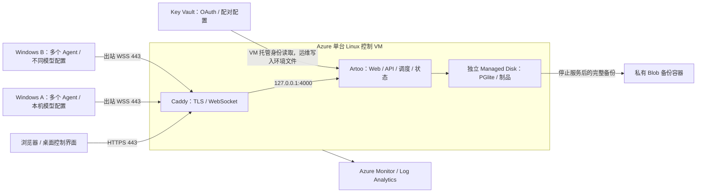

# Azure 管理调度，多电脑执行

本文面向一个可信团队：Azure 保存网页、任务、调度、审计和制品，多台 Windows 电脑运行各自的 Agent。推荐部署现有单进程服务，不改变本地执行器。首次搭建需要订阅、域名、Google OAuth、团队身份及各电脑的模型配置；这些基础设施配置完成后，日常请求通过同一个 Artoo 服务进入。

**当前范围：**仓库已有单机服务、认证配对、原生 Windows 执行和多节点协议。本文新增 Azure 基础设施模板与操作流程；没有创建 Azure 资源，没有完成真实公网 Google 登录、Azure—实体多电脑联调或 Azure 恢复演练。Windows 自治产品的当前验收范围以 [Windows 开发记录](windows-native-development.md) 和 [Agent Team 记录](agent-team-development.md) 为准。部署控制服务器本身不证明“任意产品从需求到永久发布”已验收。

## 1. 由现有实现决定的拓扑



代码依据与限制：

| 部分 | 当前实现 | 部署含义 |
| --- | --- | --- |
| 服务入口 | `apps/server/src/main.ts` 固定创建 `PgliteDbClient` | 嵌入式 PostgreSQL，使用本地目录和独占锁；当前没有通过连接串切换 Azure Database for PostgreSQL 的实现 |
| 运行状态 | 节点连接注册、实时消息和部分调度协调在单进程内 | 每个数据库只运行一个服务器；不使用 PM2 cluster、滚动重叠实例或自动扩到多个副本 |
| 制品 | `artifactDir` 下的本地内容寻址文件 | 数据盘必须保存数据库与制品；Blob 在本方案中只接收运维备份，没有替换应用制品读写适配器 |
| 身份 | Google OIDC、团队允许名单、明确 owner、设备凭证 | Azure/Entra 负责资源管理身份；不能把 Entra Easy Auth 当成已支持的 Artoo 登录 |
| Web/API | 构建后的 Web 与 `/auth`、`/api` 同源 | `npm run build:preview` 启用真实登录界面；Caddy 代理同一域名的所有路径 |
| 节点 | `/api/v1/node`、控制 `/api/v1/ws`，另有源传输生命周期连接 | 代理须保持 WebSocket、凭证和源传输请求；不将节点端口暴露到公网 |
| 产品运行 | Windows 受保护 profile 与原始进程所有权 | 本地有界应用发布、loopback URL、QuickJS/SQLite 不能通过控制服务器自动变成 Azure 常驻网站 |

不要把 PGlite 数据放到临时盘、Azure Files 共享目录或多个实例共用卷。不要单独部署前端到另一域名后假定 cookie/CORS 自动兼容。生产入口不使用本地日常验收的 dev token、测试身份或 prepared polling 模式。

## 2. Azure 资源清单与起始规格

下面是一个低并发可信团队的**容量起点**，不是压测容量保证或费用报价。模型推理由执行电脑承担。费用取决于区域、磁盘、流量和日志量；在订阅中设置预算告警。

| 资源 | 建议起点 / 用途 | 本模板 |
| --- | --- | --- |
| Resource Group | 一个环境一个组，生产与测试分开 | CLI 步骤创建 |
| VNet / 子网 / NSG | `10.46.0.0/16`、`10.46.1.0/24`；80/443 公网；22 仅运维固定 IPv4；其他入站拒绝 | 创建；与现网重叠时先修改地址段 |
| Standard 静态 Public IP / NIC | 一个固定 IPv4；域名 A 记录；也是 VM 显式出站方式 | 创建；不依赖 Azure 默认隐式出站 |
| Linux VM | Ubuntu 24.04 LTS x64，`Standard_D2s_v5`：2 vCPU / 8 GiB；SSH 密钥、Trusted Launch | 创建；区域无此 SKU 时选同级受支持 SKU |
| OS Managed Disk | 64 GiB Standard SSD；操作系统、只读版本目录、Caddy 状态 | VM 创建，删除 VM 时 detach |
| 数据 Managed Disk | 128 GiB Premium SSD LRS 起步；LUN 0，独立挂载 `/var/lib/artoo` | 创建，删除 VM 时 detach；VM 删除策略不保护资源组删除 |
| System-assigned Managed Identity | VM 读取该 Vault，写入该备份容器 | 创建并配置最小资源范围角色 |
| Key Vault Standard | RBAC，90 天软删除和 purge protection；保存服务器环境配置 | 创建；不在 Bicep/参数中放 secret |
| StorageV2 / Blob container | Standard LRS 私有 `artoo-backups`；TLS、禁共享密钥、版本/删除保留 30 天 | 创建；应用数据仍在本地盘 |
| Log Analytics / AMA / DCR | 30 天日志，1 GiB/日初始 ingestion cap；系统 warning+ Syslog | 默认创建；cap 达到后会丢失当日新日志，必须告警/调容量 |
| Action Group / CPU alert | 指定运维邮箱后，CPU 平均 >80% 持续 15 分钟告警 | `alertEmail` 非空时创建；模板部署不会发送自定义测试消息 |
| 公网域名及 A 记录 | 已有 DNS 提供商即可；域名指向静态 IP | 不创建；Azure DNS Zone 可选，不重复创建已有权威区 |
| Google OAuth Web client | 精确 HTTPS callback、允许名单、owner | Google 侧已有/新建配置，非 Azure 资源 |

Key Vault 和 Blob 的公共端点启用防火墙：只允许模板子网的 service endpoint 和运维 IP；容器无匿名权限，VM 使用 Entra 托管身份。订阅的 Contributor 不自动拥有秘密/Blob 数据读取权限。部署 Bicep 中的角色分配还需要相应 RBAC 管理权限；不要为了通过部署给应用长期 Owner。

可选增强与边界：

| 增强 | 何时添加 |
| --- | --- |
| Azure Bastion / VPN | 不保留公网 22 时；同时移除 NSG 的 SSH 规则，检查 Bastion SKU/子网要求 |
| Private Endpoints / Private DNS | 组织要求 Vault/Storage 无公共端点时；相应调整运维接入和 DNS，不能只关闭公网访问后失去运维通道 |
| Recovery Services Vault + Azure VM Backup | VM/磁盘灾难恢复的补充；必须配置并测试 Linux pre/post 脚本一致性，不能以默认 crash-consistent 快照替代应用备份 |
| Blob GRS / 独立订阅备份 / Immutable storage | 区域故障和删除防护；LRS 不提供跨区域副本，软删除/版本不等于不可篡改 WORM |
| Azure Monitor availability / 磁盘与内存规则 | 监测 HTTPS readiness、磁盘剩余量、备份年龄、进程重启及通知送达；见第 10 节 |
| ACR / 容器构建 | 将来需要经过单写者/持久化验证的容器发行时；当前 VM 部署不需要 ACR |
| Front Door / Application Gateway / WAF | 规模/组织策略需要时另行验证 WS、超时、上传和真实代理 IP；当前 server 只支持明确代理 IP，不能直接配置 CIDR 信任 |
| Azure PostgreSQL / Redis / 多副本 | 属于应用架构改造：远程 DB adapter、迁移/备份和分布式连接/调度协调均需实现和验收；本次不创建 |
| Azure OpenAI / AI Foundry | 只有某电脑明确选择相应模型供应方才需要；控制服务器不要求 Azure 模型资源 |

## 3. 创建顺序与模板使用

资源依赖顺序为：订阅/区域与额度 → Resource Group → VNet/NSG/IP → NIC/数据盘 → VM/托管身份 → Vault/Storage 和身份授权 → Monitor → 域名/TLS → 软件/秘密 → 单节点验收 → 多电脑验收 → 备份恢复演练。模板会自动排列资源依赖，不会安装 Artoo、格式化磁盘、配置 OAuth 或启动模型。

从 Windows PowerShell 使用已有 Azure CLI 和 Bicep。先复制 [参数示例](../deploy/azure/main.parameters.example.json) 到**仓库外**；替换 SSH **公钥**、真实运维公网 `/32`、区域和通知邮箱。`203.0.113.10/32` 是文档保留地址，不可直接使用。禁止填写 `0.0.0.0/0`；公钥以外不把私钥、OAuth secret、token 放到参数中。请检查所选区域的 VM SKU、配额和订阅策略。模板初次使用 `latest` Ubuntu 镜像，部署后记录实际镜像版本，重复部署时固定 `ubuntuImageVersion`。

```powershell
# 仅编译，不连接订阅或创建资源
az bicep build --file deploy/azure/main.bicep --outfile "$env:TEMP/artoo-azure.json"

# 以下是部署操作者将来执行的步骤；本文编写时没有执行
az login
az account set --subscription '<subscription-id>'
az group create --name rg-artoo-prod --location eastasia
az deployment group what-if --resource-group rg-artoo-prod --template-file deploy/azure/main.bicep --parameters '@C:/ArtooDeploy/prod.parameters.json'
az deployment group create --resource-group rg-artoo-prod --name artoo-infra-v1 --template-file deploy/azure/main.bicep --parameters '@C:/ArtooDeploy/prod.parameters.json'
az deployment group show --resource-group rg-artoo-prod --name artoo-infra-v1 --query properties.outputs --output json
```

保存部署 ID、无秘密的 outputs、模板 commit/hash、实际 VM image version、SKU、磁盘 ID 与资源区域。`what-if` 是在线 ARM 检查，不是离线编译；编译成功不保证区域额度、资源创建和数据面访问成功。对数据盘/备份账户设置合适的删除锁，并单独保护备份；不要以删除整个资源组完成普通版本回滚。

## 4. Linux 主机和持久磁盘

以下 Bash 命令在 **Azure Linux VM** 中执行，Windows 执行电脑仍原生运行，无需 WSL。软件安装使用官方签名仓库；先安装 Node **24+ 的已审核具体版本**、npm 11+、Git、Caddy 2 和 Azure CLI，记录版本。不要在服务启用后通过不固定版本的安装命令自动更新。

1. 通过 SSH 公钥连接运维账户。核对 `node --version`、`npm --version` 和 `command -v node`。现有服务模板使用 `/usr/bin/node`；其他安装路径必须在 service drop-in 的 `ExecStart` 中显式替换，后文维护命令也使用同一绝对路径。
2. 执行 `lsblk -o NAME,SIZE,TYPE,FSTYPE,UUID,MOUNTPOINTS`，按 Azure 的 **LUN 0 与数据盘资源 ID** 核对新数据盘。设备可能是 SCSI 或 NVMe，不能猜 `/dev/sdb`，更不能格式化 OS/临时盘。只有确认新盘无分区、无文件系统、无历史数据后，按 [Azure Linux 挂盘指南](https://learn.microsoft.com/en-us/azure/virtual-machines/linux/attach-disk-portal) 创建 ext4 文件系统。
3. 把数据盘挂载到 `/var/lib/artoo`；在 `/etc/fstab` 使用其 UUID，如 `UUID=<实际UUID> /var/lib/artoo ext4 defaults,nofail 0 2`。保留现有 fstab，运行 `mount -a`，检查 `findmnt /var/lib/artoo` 和重启后的同一 UUID。`nofail` 不应导致应用在缺盘时写到 OS 盘，下一节增加强制 mountpoint 检查。
4. 创建服务用户及目录：

```bash
sudo useradd --system --home-dir /var/lib/artoo --shell /usr/sbin/nologin artoo
sudo chown artoo:artoo /var/lib/artoo
sudo chmod 0700 /var/lib/artoo
sudo install -d -o root -g artoo -m 0750 /etc/artoo
sudo install -d -o root -g root -m 0755 /opt/artoo/releases
sudo install -d -o artoo -g artoo -m 0700 /var/backups/artoo
```

若用户或目录已存在，检查后复用，不重复创建/改变其他服务的权限。数据目录中将包含 `db`、`artifacts`、服务端 workspaces；Windows 工作目录仍在各电脑本地。备份暂存目录在 OS 盘，需监控容量或单独配置备份盘；它不是最终灾备副本。

## 5. 固定版本、秘密与 Google 登录

在 `/opt/artoo/releases/<完整commit SHA>` 准备已审核的同一代码版本，以部署操作者身份构建，不能复用 Windows 的 `node_modules`：

```bash
cd /opt/artoo/releases/<完整commit-SHA>
npm ci
npm run build:preview
```

只发布通过仓库所需检查的 commit。Linux 依赖安装/构建及宿主健康仍须在该环境验证；已有 Windows CI 不代替 Linux 部署验证。代码及构建产物允许 `artoo` 读取，但只允许部署操作者/root 写入；服务用户不能修改代码。版本目录不要保留 `.env`。首次建立 `/opt/artoo/current` 指向该版本，后续只在服务停止时更换链接。

Google 创建或复用 **Web application** OAuth client，登记 `https://artoo.<你的域名>/auth/google/callback`。配置 consent screen、允许的受信团队，避免把短期测试模式当长期登录配置。域名必须与实际访问 origin 完全相同，不能填写 VM 内网地址。

在受限文件中准备完整的 `artoo.env`，按 `.env.example` 填写以下值。普通 SSH/CI 日志不显示文件内容：

```dotenv
NODE_ENV=production
GOOGLE_CLIENT_ID=<真实客户端ID>
GOOGLE_CLIENT_SECRET=<秘密>
GOOGLE_REDIRECT_URI=https://artoo.example.com/auth/google/callback
AUTH_ALLOWED_EMAILS=owner@example.com,member@example.com
AUTH_OWNER_EMAILS=owner@example.com
ARTOO_PAIRING_PEPPER=<生成一次并长期保存的高熵秘密>
ARTOO_DATA_DIR=/var/lib/artoo
ARTOO_HOST=127.0.0.1
ARTOO_PORT=4000
ARTOO_TRUSTED_PROXIES=127.0.0.1
ARTOO_DESKTOP_CORS=1
ARTOO_DESKTOP_CORS_ORIGINS=null
ARTOO_CONTROL_TOKEN_TTL_MS=2592000000
```

owner 必须同时满足允许名单；若配置 `GOOGLE_HOSTED_DOMAIN`，还必须属于该 Workspace 域。生产认证和 Secure cookie 自动启用，不能关闭。保持稳定的 pairing pepper，并在恢复时使用同一秘密；更换秘密/凭证属于单独的轮换操作。

**开始 Agent 工作前还必须设置 `ARTOO_AI_DATA_SHARING_POLICY`**，按 [AI data sharing](ai-data-sharing.md) 描述所有电脑实际使用的供应方，并让每位使用者在 Settings 完成对应版本的同意。缺少配置时可以浏览/配对，但不能开始 Agent 工作。把该公开 JSON 字符串以单引号包裹的 dotenv 值加入同一个 env 文件，例如 `ARTOO_AI_DATA_SHARING_POLICY='{"mode":"external","providers":[{"id":"实际id","name":"实际接收方","privacy_url":"https://实际公开隐私政策URL"}]}'`，使用真实、符合 schema 的字段替换示意值，不把 API key 放入其中。只有全部模型都本地处理且不向外部供应方发送数据时才使用 local 模式；本地 Aerial 网关不等于模型数据未离开电脑。

推荐把整个受限 env 文件作为 Vault secret `artoo-server-env` 保存，记录版本。此文件是 Artoo 的环境配置，不是 Azure 原生 Key Vault reference；应用没有自动解析 reference 的代码。给运维身份该 Vault 的 **Key Vault Secrets Officer** 后，可使用文件上传且不输出 secret：

```text
az keyvault secret set --vault-name <output-keyVaultName> --name artoo-server-env --file <受限env文件> --output none
```

在 VM 上使用其托管身份下载，路径只用于受限临时目录。以下命令无 secret 参数/输出；需要已安装官方 Azure CLI，RBAC 生效后执行：

```bash
sudo install -d -o root -g root -m 0700 /run/artoo-secrets
sudo env AZURE_CONFIG_DIR=/run/artoo-secrets/azure az login --identity --allow-no-subscriptions --output none
sudo env AZURE_CONFIG_DIR=/run/artoo-secrets/azure az keyvault secret download \
  --vault-name <vault-name> --name artoo-server-env --version <已批准secret版本> \
  --file /run/artoo-secrets/artoo.env --encoding utf-8 --output none
sudo install -o root -g artoo -m 0640 /run/artoo-secrets/artoo.env /etc/artoo/artoo.env
sudo rm -- /run/artoo-secrets/artoo.env
```

首次运行使用新临时文件；轮换时保留旧版本和回滚方案，更新受限文件后在维护窗口重启。`/run/artoo-secrets/azure` 是 root 专用临时 CLI 缓存，不打包进备份，重启清除。Vault 防火墙必须允许执行下载的 VM 子网，运维上传必须来自允许 IP。VM 身份不授予应用 Azure 资源部署权限。

## 6. systemd、DNS、TLS 和服务启动

复用 [已有 service](../deploy/artoo-preview.service) 与 [Caddyfile](../deploy/Caddyfile)：

```bash
sudo install -o root -g root -m 0644 /opt/artoo/current/deploy/artoo-preview.service /etc/systemd/system/artoo-preview.service
sudo install -d -m 0755 /etc/systemd/system/artoo-preview.service.d
sudoedit /etc/systemd/system/artoo-preview.service.d/data-mount.conf
```

drop-in 内容如下，避免未挂载数据盘时初始化另一个数据库：

```ini
[Unit]
RequiresMountsFor=/var/lib/artoo

[Service]
ExecStartPre=/usr/bin/mountpoint -q /var/lib/artoo
```

若 Node 不在 `/usr/bin/node`，另加 `[Service]` 下的空 `ExecStart=`，再填 `ExecStart=<实际绝对node路径> /opt/artoo/current/scripts/start-preview.mjs`；维护命令使用同一 Node。不要添加多个 server 实例。服务器 graceful stop 的预算是现有 90 秒，停止超时应调查，不把强杀当成干净关闭。

在权威 DNS 建立域名的 A 记录到模板静态 IP，初次 TTL 可用 300 秒；无 IPv6 listener 时不配置 AAAA。让 80/443 到达 Caddy（80 用于重定向/ACME），4000 不开放。合并 Caddyfile 到已有配置并替换域名，保留 `reverse_proxy 127.0.0.1:4000`，不配置短 WS stream timeout。不要在公开 access log 中记录 query/token、Authorization、cookie、OAuth callback 参数或任务正文；现有模板默认没有开启访问日志。

```bash
sudo systemd-analyze verify /etc/systemd/system/artoo-preview.service
sudo caddy validate --config /etc/caddy/Caddyfile
sudo systemctl daemon-reload
sudo systemctl enable --now artoo-preview
sudo systemctl reload caddy
curl --fail --silent --show-error https://artoo.example.com/health/live
curl --fail --silent --show-error https://artoo.example.com/health/ready
curl --silent --output /dev/null --write-out '%{http_code}\n' https://artoo.example.com/api/v1/bootstrap
```

预期依次为 `{"status":"ok"}`、`{"status":"ready"}` 和未登录 `401`。第一次生产启动创建默认组织、配置 owner 和项目，不创建虚构在线电脑。readiness 只检查数据库可读，不证明模型、节点、OAuth 或制品下载正常。保留本次 service log 的无秘密错误摘要、版本与健康结果。

## 7. 每台 Windows 电脑接入与不同 Agent

所有电脑输入同一 origin：`https://artoo.example.com`。npm daemon 的安装、无桌面配对和启动步骤见 [Web 与 Windows daemon 部署方案](web-deployment-plan.zh-CN.md#5-windows-daemon-接入)。每台电脑选择 npm CLI 或桌面 worker 其中一个作为同一设备的执行入口，不同时启动两个 daemon。重复以下步骤，每台电脑保留自己的身份、工作目录和模型凭证：

1. npm 路径使用 Node 24+、npm 11+。本次候选为 `@jiayunxie/artood@0.1.0-rc.1`，**尚未发布**；待实际发布并验证后使用该固定版本安装。桌面路径仍安装经过本地验证的同版 Windows Artoo 包，核对 SHA-256/签名状态。npm 发布不等于 Windows 安装程序签名；首次只能使用控制界面也不影响 Azure server。
2. **该设备的实际使用者以本人受信账号在 Web 登录**，在 Settings → Connect a device 选择 Windows，生成自己的单次配对码。桌面端输入 origin、设备名和配对码；npm CLI 当前没有 `pair` 子命令，按部署方案调用现有 `/api/v1/devices/claim` 接口领取自己的设备凭证。配对码携带生成者身份/权限，不让 owner 为其他成员代生成；同一人可以为自己的多台电脑分别配对。不要复制其他电脑的凭证或把配对码、返回 token 发到日志。
3. 若该设备尚无 computer 绑定，owner/admin 在 Settings → Devices 选择 **Enroll computer** 并确认。配对与登记执行电脑是两个步骤；未登记不能启动 worker。npm 配置中的 `ARTOO_NODE_ID` 使用登记后的 `computer_id`，不能使用 `device.id`。
4. npm 路径把节点凭证和 `ARTOO_*` 设置放在工作目录之外、仅本机账户和管理员可读的环境文件中，通过 Node 的 `--env-file` 启动 `artood start`。桌面路径在 Settings → This computer 配置本机 CLI 的绝对路径、允许工作目录和运行时，再启动 worker；只有桌面保存的凭证使用 Electron `safeStorage`，npm 环境文件没有自动加密。每个工作根必须实际存在；`C:\Products` 是该电脑的路径，不是 Azure VM 的共享盘。
5. **owner/admin** 在 **Computers** 页面确认 computer、runtime 的当前状态，打开 **Register agent workspace**，选择该电脑的 runtime 和本地 workspace，点击 **Register agent**，再在 Agents 查看实例。普通成员没有注册入口，需由 owner/admin 完成这一步。实例绑定 **computer + runtime + workspace**；多个 Agent 可以在同一电脑，也可以分布不同电脑。名称建议包含电脑/职责，例如 `pc-a-builder`、`pc-b-reviewer`。独立审核需要不同 Agent 身份，不能以相同身份换一个显示名称代替。
6. 各电脑独立配置模型。例如 A 使用本机 Aerial `http://127.0.0.1:18181/v1` 与其实际可用 Codex 模型；B 可使用自己的 Aerial/另一模型，或配置并登录 Claude CLI。模型名以该电脑供应方目录和实际调用为准。`127.0.0.1` 永远指当前执行电脑，Azure 和 B 不能通过 A 的 loopback 地址使用 Aerial。
7. 在每台电脑完成一次受限小任务，记录实际选择的电脑/Agent/runtime、模型可用性、产物归属及正常取消。CLI 文件存在只证明程序被发现，不证明模型鉴权或模型名称有效。
8. 自治开发另需每个执行/审核节点的受保护验证 profile、原生 helper、浏览器、源码交接与发布配置；按 [Windows 原生说明](windows-native-development.md) 和 [来源节点配置](windows-native-source-nodes.md) 准备。npm CLI 的 `artood start --windows-supervised` 复用这些准入检查；安装包带有 helper 不会自动创建本机 profile 或授予全部自治能力。配置、helper、验证器和制品证据应在 Agent 可写根之外。

**网络：**执行电脑仅需要出站 DNS 和 TCP 443 到 Artoo 域名，以及模型供应方所需出站连接。控制/节点 WebSocket、源码传输与制品上传通过同一 HTTPS origin。无需给执行电脑做公网 NAT/入站端口映射，也不开放 18181。默认方案 Caddy 与 server 同机，`ARTOO_TRUSTED_PROXIES=127.0.0.1`；不可用 `*` 或某个宽 CIDR 替代。

企业网络须允许长连接 WebSocket Upgrade。当前传输使用 Node WebSocket，没有已验收的任意 HTTP CONNECT 代理配置入口；不能假定设置 `HTTP_PROXY` 就能工作。优先为 Artoo 域名提供正常 TLS/WS 出站。企业 TLS 检查需要分别验证 Electron、Node 和模型 CLI 的证书信任，不设置 `NODE_TLS_REJECT_UNAUTHORIZED=0` 或关闭证书验证。网络重连后检查当前 computer/daemon/runtime 和在途任务状态，过期或撤销凭证必须重新配对；控制会话默认 30 天。断线期间未知执行不能视为已停止，不能手工释放租约后重复运行。

电脑间不会自动共享文件。跨节点工作通过授权的源码交接流程及各节点能力匹配；Git/workspace 设置须分别就绪。**本文未完成 Azure 与两台实体电脑的实测**，当前电脑上的多 Agent/受控多节点证据不等于实体多机完整自治验收。

## 8. 联调验收顺序

在开放团队日常使用前记录同一版本的以下结果，不只看首页或健康 HTTP 200：

1. 公网 TLS 链与域名、HTTP→HTTPS、Web 深链接可用；未登录 REST 401，未配对节点不能接入；生产不存在开发 token 绕过。
2. 真实 Google owner 和允许成员可登录；非允许邮箱拒绝；logout/设备撤销后 API 与实时连接失效。
3. Windows A 配对、enroll、worker 在线，真实本机 runtime 调用成功，上传制品可从另一浏览器认证下载；不使用测试身份/伪造 provider 响应。
4. Windows B 独立配对，任务明确分配到 B；A/B 使用不同 Agent/runtime，B 的路径和模型凭证没有复制到 Azure 或 A。
5. Web 两个会话看到相同任务与消息；执行电脑断网/恢复、worker 重启、控制 VM graceful restart 后，事件补齐、在途状态/租约无重复执行；当前 publication session 的失效需按真实状态处理，不能借用历史成功回执。
6. 自治流程只选择实际通过资格的节点/profile，单独记录调研、设计、实现、验证、独立审核、发布的产物与退出证据。失败阶段不标为完成；不要为了让部署显得成功缩减验收标准。
7. 完成下一节新目录恢复，核验目标/任务历史、设备记录、制品下载和运行恢复，才能给出测量后的 RPO/RTO。

## 9. 备份、升级与回滚

初始建议 RPO 为 24 小时，升级前额外备份；RTO 先以 1–2 小时作为运维目标，实际须通过演练测量。大文件/数据库增长后应缩短备份间隔或规划更强架构。单 VM 不提供无中断升级/高可用；备份期间暂停新请求并等待在途执行安全结束，未知远端执行不强行认定已停止。

服务停止并确认原进程正常退出后，使用项目已有离线工具。每次目的目录必须全新；数据库独占锁会拒绝在服务器运行时备份：

```bash
BACKUP=/var/backups/artoo/2026-11-09T020000Z  # 每次使用唯一时间戳
(
  set -euo pipefail
  sudo systemctl stop artoo-preview
  test "$(sudo systemctl show artoo-preview -p ActiveState --value)" = inactive
  test "$(sudo systemctl show artoo-preview -p MainPID --value)" = 0
  test "$(sudo systemctl show artoo-preview -p Result --value)" = success
  test "$(sudo systemctl show artoo-preview -p ExecMainStatus --value)" = 0
  sudo -u artoo /usr/bin/node --env-file=/etc/artoo/artoo.env /opt/artoo/current/scripts/storage.mjs backup "$BACKUP"
  sudo systemctl start artoo-preview
)
```

任何停止检查或备份失败都会中止子 shell，需查看原退出状态再处置，不自动重启/掩盖失败。仅在备份命令成功后继续；失败保留 `.partial-*` 与诊断，不把其作为可恢复备份。CLI 导出数据库 archive、制品与 checksum/size manifest，**不包含**操作系统、release 目录、环境 secrets、服务器 `ARTOO_WORKSPACE_ROOT` workspaces、Windows 本机源码/CLI 配置或生成产品的 SQLite/发布目录。它们必须按自己的恢复策略另行保存。恢复不复制现场运行中的数据库目录。

使用 VM 托管身份，把已完成的备份上传到唯一 Blob 前缀，不覆盖以前备份。以具有本地备份读取权限的运维身份运行：

```bash
sudo env AZURE_CONFIG_DIR=/run/artoo-secrets/azure az login --identity --allow-no-subscriptions --output none
sudo env AZURE_CONFIG_DIR=/run/artoo-secrets/azure az storage blob upload-batch --account-name <storage-account> --destination artoo-backups \
  --destination-path 2026-11-09T020000Z --source "$BACKUP" --auth-mode login --overwrite false --output none
```

读回到**另一个新目录**、比对 manifest 并调用 `storage.mjs restore <已下载backup目录> <全新恢复数据目录>`，才验证了 Azure 备份传输及数据库恢复。上传命令使用 root 读取 `artoo` 的 0700 备份目录，不放宽备份文件权限；重启后需要重新创建前述 root 专用 `/run/artoo-secrets` 目录。恢复下载文件也应限制权限，再以有权读取它们的 `artoo` 身份运行恢复工具，避免把 root 所有的数据库交给普通服务用户。给灾备操作者单独授予 Blob Data Reader 和相应 Vault 读取权限，避免原 VM 身份丢失后无法取回备份。计划任务/备份失败告警需要实际安装和验证；Bicep 创建容器不代表已经有每日备份。

例如在原 VM 上只做恢复演练，不切换在线服务：

```bash
DOWNLOAD=/var/backups/artoo/download-2026-11-09T020000Z
test ! -e "$DOWNLOAD" || exit 1  # 必须不存在，若已存在选择新的演练目录
sudo -u artoo mkdir -m 0700 "$DOWNLOAD" || exit 1
sudo env AZURE_CONFIG_DIR=/run/artoo-secrets/azure az storage blob download-batch \
  --account-name <storage-account> --source artoo-backups --destination "$DOWNLOAD" \
  --pattern '2026-11-09T020000Z/*' --auth-mode login --output none || exit 1
# 仅此新建演练目录：先核对绝对路径与实际下载清单，再设置服务用户所有权
sudo chown -R artoo:artoo /var/backups/artoo/download-2026-11-09T020000Z
sudo -u artoo /usr/bin/node --env-file=/etc/artoo/artoo.env /opt/artoo/current/scripts/storage.mjs restore \
  /var/backups/artoo/download-2026-11-09T020000Z/2026-11-09T020000Z /var/lib/artoo/restored-check-2026-11-09T020000Z
```

下载失败/文件不完整则停止，保留失败目录；恢复命令会校验全部内容后再发布新目录。上述工具校验和 DB health 成功还不等于业务恢复成功；在隔离网络/端口的恢复环境中用相同代码检查登录、历史和制品，并避免恢复副本与正式 server 同时向真实节点派单。灾备新 VM 还必须恢复受限配置、角色和防火墙访问，不能假定原 VM 的 system-assigned identity 自动迁移。

同名 VM 删除重建后，其托管身份的 principal ID 会改变。模板通过 [数据访问授权模块](../deploy/azure/vm-data-access.bicep)，按目标资源、实际 principal ID 和角色 ID 生成授权名称，避免尝试修改旧授权不可变的 principal。旧身份的遗留授权不会自动删除；由运维核对后清理。若曾部署旧版按 VM 资源 ID 命名的授权，升级模板前须在维护窗口记录两条旧授权的精确 assignment ID、scope、principal ID 和 role definition ID，由有 RBAC 管理权限的操作者迁移这两条授权：核对并移除旧记录，再部署当前模板建立新授权；不要批量删除同一 scope 或 principal 的其他授权。此迁移会短暂中断数据访问，需保留旧授权记录及恢复方案。等待权限传播后验证新 VM 可读取 Vault、上传并读回备份，失败时保留诊断并恢复所需授权后再继续服务。

升级步骤：在新版本目录完成构建/检查 → 维护暂停与排空 → 停止服务 → 完整备份 → 保存当前 commit、环境 secret 版本和数据路径 → 更换 `/opt/artoo/current` → 启动并执行第 8 节关键路径。迁移会在启动时按 append-only journal 执行。升级前备份保留与旧代码绑定。

回滚步骤：停服务 → 用**旧版代码对应的备份**恢复到同一数据盘下全新目录，如 `/var/lib/artoo/restored-<id>` → 改 `ARTOO_DATA_DIR` 指向新目录，清除/更新旧的 `ARTOO_DB_DIR`、`ARTOO_ARTIFACT_DIR` override → `current` 指回旧版 → 使用对应配置启动 → 先验证登录/历史/制品/节点状态，再开放流量。保留升级后的原数据用于分析。禁止旧代码直接打开升级后的 DB；代码回滚不等于数据回滚。

若独占锁阻止 crash 后启动，停止自动重启，保留日志并用同一版本/环境的 `storage.mjs unlock` 检查；只允许该工具确认原 owner 已死亡后解锁，不手工删锁。Azure VM Backup 的 crash-consistent 快照不保证上述应用级一致性；需要 pre/post 停启/导出 hooks 和真实恢复演练。数据盘 detach 不是备份，Blob LRS 不是跨区域灾备。

## 10. 监控和 CI/CD 身份

模板安装 AMA，DCR 收集系统 warning+ Syslog；需确认 Ubuntu 的 rsyslog/AMA 正常，使用不含敏感数据的 `logger -p daemon.warning 'artoo monitoring probe'` 验证日志到达。systemd journal 不一定自动成为 Syslog 数据源，不能因创建 workspace 就宣称应用日志已经采集。保留受限 journal；需要应用日志时配置经过脱敏的 Syslog/custom text DCR。不要采集 token URL、OAuth callback query、cookie、模型密钥或任务源代码。

还要配置并实测：HTTPS `/health/ready` 连续失败、VM 可用性、内存、数据盘/备份暂存盘剩余量、服务反复重启、最后成功备份年龄 >26 小时、备份/恢复失败，以及 Log Analytics 达到 daily cap。CPU 告警不能代替这些项。设置通知责任人和维护窗口；上线前送一条经运维授权的告警验证通知链。默认 server 没有 Application Insights SDK/Prometheus exporter，不虚构已有业务指标。

已有 [Preview gates](../.github/workflows/preview.yml) 是构建/测试流程，没有 Azure 发布步骤。建议后续发布 workflow 只接收已验证 commit/制品摘要，以 GitHub Environment `production` 为部署边界，用 GitHub OIDC 对接单独 Entra application 或 user-assigned managed identity：

- 信任只绑定该 repo 的 `environment:production`，权限 `id-token: write`、`contents: read`；不使用长寿命 Azure client secret，不让任意 PR 获取生产身份。
- CI 构建和部署分开；Linux 发行包包含固定 commit、依赖锁、构建摘要与测试证据，不包含 `.env`、Windows 凭据或业务数据。
- 基础设施身份授予该资源组所需 Contributor；角色分配由受控 bootstrap/RBAC 管理身份完成，普通 app-deploy 身份不需要创建角色。
- 发布身份只获得目标 VM 的受限发布能力及必要制品读取权。Azure VM Run Command 等同主机高权限执行，不能当普通只读权限；SSH 使用独立、受限部署账户。选择其中一种已经审核的发布通道，不同时开放多种后门。
- 在安装新的 workflow 前保留现有分支保护/发布策略。未来自动部署仍执行维护、备份、单实例切换、健康与回滚步骤；不启用两个版本同时写一个 PGlite 目录。

本次没有安装 Azure 发布 workflow、创建联邦身份、授予真实 Azure 权限或发送外部通知。初次可按本文执行有记录的人工发布，确认拓扑和恢复后再自动化同一流程。

## 11. 官方依据及验证边界

以下 Microsoft Learn 页面在 2026-11-09 读取核对；区域可用性、价格、订阅策略以实际部署时结果为准：

- [Linux VM 数据盘与 UUID 挂载](https://learn.microsoft.com/en-us/azure/virtual-machines/linux/attach-disk-portal)：持久盘识别和自动挂载。
- [Azure 显式出站连接](https://learn.microsoft.com/en-us/azure/virtual-network/ip-services/default-outbound-access)：本方案使用 NIC 关联 Public IP，不依赖默认出站。
- [Key Vault Azure RBAC](https://learn.microsoft.com/en-us/azure/key-vault/general/rbac-guide)：Secrets User 与 Secrets Officer 的数据面职责。
- [Azure CLI Blob 数据授权](https://learn.microsoft.com/en-us/azure/storage/blobs/authorize-data-operations-cli)：数据 RBAC 与 `--auth-mode login`，控制面 owner 不等于数据面权限。
- [Linux VM 应用一致性备份](https://learn.microsoft.com/en-us/azure/backup/backup-azure-linux-app-consistent)：pre/post hooks、失败回退与一致性差别。
- [Azure Monitor Agent Syslog](https://learn.microsoft.com/en-us/azure/azure-monitor/vm/data-collection-syslog)：DCR 和 Linux Syslog 转发要求。
- [GitHub Actions OIDC 到 Azure](https://learn.microsoft.com/en-us/azure/developer/github/connect-from-azure-openid-connect)：联邦身份与最小权限。

验证记录：本次仅进行仓库架构核对、官方文档读取和 Bicep 本地编译/静态检查。模板只创建控制基础设施，未做真实 ARM what-if/部署、VM 安装、OAuth/公网 WebSocket、多电脑模型执行、定时备份或恢复演练。控制服务上云与生成产品长期上云是两个交付范围；后者还需要专用 Azure 发布执行器、不可变产物、运行/数据契约、健康策略和数据恢复的实现与验收。
