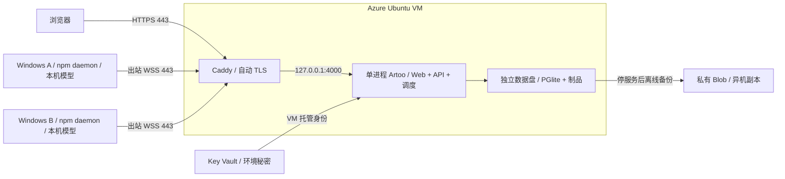

# Artoo Web 与 Windows daemon 部署方案

采用 **Azure 单台 Linux 控制服务器 + 多台 Windows 执行电脑**。Web、API、调度和数据集中在一个 HTTPS 域名；模型和代码执行留在各台 Windows 电脑。本方案复用现有 Azure 模板，不要求先改造数据库或运行时。

本文交付的是可执行部署方案，未创建云资源，也不表示公网环境已经验收。npm 包 [`@jiayunxie/artood@0.1.0-rc.1`](https://www.npmjs.com/package/@jiayunxie/artood/v/0.1.0-rc.1) 已正式发布，`next` 指向该版本；当前 `latest` 仍为 `0.0.0-stage` 占位，安装须使用下列固定版本。本机 Microsoft npm feed 仍不可见（E404）；独立 [Windows 线上安装验证](https://github.com/Xiejiayun/artoo/actions/runs/42615273316) 已从官方 registry 安装同一固定版本，并通过包哈希、manifest/CLI 和 fixture 配对连接检查，详见 [发行状态](release-convergence-2026-11-09.md#发行与部署状态)。服务器固定到通过检查的完整 commit SHA，记录该 SHA 与 npm 版本的兼容关系。

## 1. 拓扑与容量起点



| 部分 | 首次部署选择 | 原因 |
| --- | --- | --- |
| 服务器 | Ubuntu 24.04，2 vCPU / 8 GiB，如 `Standard_D2s_v5` | 可信小团队容量起点；模型不在 VM 推理，实际容量需测量 |
| 磁盘 | OS 64 GiB；独立数据盘 128 GiB，挂载 `/var/lib/artoo` | 重建代码目录时保留数据库和制品；不使用临时盘或共享盘 |
| 网络 | 静态公网 IP；80/443；SSH 仅运维固定 IP | Windows 不需公网地址或入站端口映射 |
| Web/API | Caddy 同源代理到一个 Node 24+ 进程 | 保持 cookie、OAuth、WebSocket 和下载路径一致 |
| 身份 | Google OAuth、团队允许名单、明确 owner | 当前实现支持的登录方式 |
| 备份 | 私有 Blob；保留成功备份及 manifest | Azure 数据盘和单机快照不能代替应用恢复验证 |
| 秘密 | Key Vault；VM 下载指定版本到受限 env 文件 | 不放进 Git、npm 包或 Web 构建 |

费用由 VM、OS/数据盘、备份容量、出站流量、日志及域名构成。使用 [Azure 价格计算器](https://azure.microsoft.com/pricing/calculator/) 按实际区域报价并设置预算告警；这里没有实时价格或已测并发量，故不承诺月费与用户容量。

## 2. 上线前准备

准备以下值，秘密通过受限配置文件或 Key Vault 交付：

| 配置 | 需要确定的内容 |
| --- | --- |
| Azure | 订阅、区域、资源组、部署权限、VM 配额 |
| 域名 | 例如 `artoo.example.com`，可管理其 DNS A 记录 |
| 运维访问 | SSH 公钥、运维公网 `/32`、告警接收人 |
| Google OAuth | Web application client ID/secret，回调 `https://<域名>/auth/google/callback` |
| 团队 | 允许登录邮箱、owner 邮箱；owner 也必须满足允许规则 |
| 模型披露 | 所有执行电脑实际使用的外部供应方及公开隐私政策 URL |
| 发行版本 | 已验证的服务器 commit、npm 包名/精确版本、构建与测试记录 |
| 恢复责任 | 备份存储权限、秘密恢复权限、恢复演练负责人 |

不要复制其他电脑的节点身份。模型 API key 保存在对应执行电脑，Web 服务器只保存公开的供应方披露。开始 Agent 工作前，使用者须在 Settings 同意该版本的 AI data sharing。

## 3. 创建 Azure 与安装服务

完整命令、磁盘识别和权限步骤沿用 [Azure 运行手册第 3–6 节](azure-deployment.md#3-创建顺序与模板使用)。执行顺序如下：

1. 在仓库外复制并填写 [参数示例](../deploy/azure/main.parameters.example.json)。检查真实 SSH 公钥、运维 `/32` 和区域；示例 IP 不能上线使用。
2. 编译模板，执行 ARM `what-if`，核对后创建资源。模板创建基础设施，不自动安装 Artoo、配置 OAuth 或启动备份计划。
3. 在 VM 中按 LUN 和资源 ID 确认数据盘，按运行手册挂载到 `/var/lib/artoo`。保留 `RequiresMountsFor` 和 `mountpoint` 启动检查，防止缺盘时写到 OS 盘。
4. 安装已审核的 Node 24+ 具体版本、npm 11+、Git、Caddy 和 Azure CLI。创建独立 `artoo` 服务用户；代码只允许部署账户修改。
5. 把已通过检查的 commit 放入 `/opt/artoo/releases/<完整SHA>`，构建后令 `/opt/artoo/current` 指向该版本。Linux 应重新 `npm ci`，不能复制 Windows 的 `node_modules`。
6. 配置下一节环境文件和域名，安装现有 systemd/Caddy 模板，启动唯一 server，完成第 6 节验收。

Windows 运维终端的基础设施命令：

```powershell
az bicep build --file deploy/azure/main.bicep --outfile "$env:TEMP/artoo-azure.json"
az login
az account set --subscription '<subscription-id>'
az group create --name rg-artoo-prod --location '<region>'
az deployment group what-if --resource-group rg-artoo-prod --template-file deploy/azure/main.bicep --parameters '@C:/ArtooDeploy/prod.parameters.json'
az deployment group create --resource-group rg-artoo-prod --name artoo-infra-v1 --template-file deploy/azure/main.bicep --parameters '@C:/ArtooDeploy/prod.parameters.json'
```

每条命令成功后再执行下一步。发布 commit 应通过仓库规定的 typecheck、build、单元测试和 Web E2E；在 Linux 发行目录构建：

```bash
cd /opt/artoo/releases/<完整SHA>
npm ci
npm run build:preview
```

使用 [systemd 模板](../deploy/artoo-preview.service) 和 [Caddyfile](../deploy/Caddyfile)。将域名 A 记录指向 VM 静态 IP；无 IPv6 listener 时不配置 AAAA。Caddy 负责证书申请和续期，80/443 必须可达，4000 仅 loopback。反向代理须保留 WebSocket Upgrade，不配置过短的长连接超时。

## 4. 生产环境配置

以下是 `/etc/artoo/artoo.env` 的必要配置示意。替换所有示例，文件 `root:artoo`、`0640`；建议保存到 Key Vault `artoo-server-env` 并下载批准的固定版本。应用本身不会解析 Azure Key Vault reference。

```dotenv
NODE_ENV=production
ARTOO_HOST=127.0.0.1
ARTOO_PORT=4000
ARTOO_DATA_DIR=/var/lib/artoo
ARTOO_TRUSTED_PROXIES=127.0.0.1
GOOGLE_CLIENT_ID=<真实客户端ID>
GOOGLE_CLIENT_SECRET=<秘密>
GOOGLE_REDIRECT_URI=https://artoo.example.com/auth/google/callback
AUTH_ALLOWED_EMAILS=owner@example.com,member@example.com
AUTH_OWNER_EMAILS=owner@example.com
ARTOO_PAIRING_PEPPER=<生成一次并安全保留的随机秘密>
ARTOO_CONTROL_TOKEN_TTL_MS=2592000000
ARTOO_AI_DATA_SHARING_POLICY='{"mode":"external","providers":[{"id":"实际供应方id","name":"实际接收方","privacy_url":"https://实际公开隐私政策URL"}]}'
```

供应方 ID 须为小写字母/数字/连字符，URL 须为实际公开 HTTPS 地址，具体 schema 见 [AI data sharing](ai-data-sharing.md)。只有所有模型确实在本机处理、没有向外部供应方传送数据时，才使用 `{"mode":"local","providers":[]}`；本地模型网关不代表请求没有离开电脑。

仅 Web + npm daemon 不需要启用桌面 CORS。若同时使用 `file://` Electron 界面，再按 `.env.example` 设置 `ARTOO_DESKTOP_CORS=1` 与明确 origin；不得使用 `*`。公网环境始终启用生产认证，不使用开发 token、测试用户或 prepared polling。

环境文件不进入代码目录或 npm 包。数据库恢复时必须保留对应 pairing pepper；秘密轮换、OAuth client 修改和节点重新配对分别记录。

## 5. Windows daemon 接入

npm CLI 负责启动现有 daemon，命令为 `artood start`；当前没有 `pair`、`status` 或自动注册 Windows 服务的子命令。安装/构建说明见 [npm daemon README](../scripts/npm-daemon/README.md)。以下为 PowerShell 7、Node 24+ 的接入流程，使用已发布的固定版本 `0.1.0-rc.1`；[线上 Windows 安装验收](https://github.com/Xiejiayun/artoo/actions/runs/42615273316) 已通过，范围为托管 Windows 的固定版本校验、fixture 配对/登记、WebSocket 心跳与正常停止；不包含真实模型或 native-supervisor 资格。`next` 指向该版本，`latest` 仍是占位版本，不使用省略版本号的安装命令。

```powershell
npm install --global '@jiayunxie/artood@0.1.0-rc.1'
artood.cmd --version
artood.cmd --help
```

### 配对与登记

设备实际使用者用自己的允许账号在 Web Settings → Connect a device 选择 Windows，获取单次配对码。在该电脑调用现有 claim API；输入用 `Read-Host`，不要把 token、配对码粘贴进命令历史或输出整个响应：

```powershell
$artooOrigin = 'https://artoo.example.com'
$artooCode = Read-Host '输入自己的单次配对码' -MaskInput
$artooClaim = Invoke-RestMethod -Method Post -Uri "$artooOrigin/api/v1/devices/claim" -ContentType 'application/json' -Body (@{
  code = $artooCode
  platform = 'windows'
  app_version = '0.1.0-rc.1'
  display_name = $env:COMPUTERNAME
} | ConvertTo-Json -Compress)
$artooCode = $null
```

owner/admin 在 Web Settings → Devices 对这台设备选择 **Enroll computer**。普通成员可领取自己的凭证，但不能替代管理员登记执行电脑。完成登记后，在同一 PowerShell 会话查询自己的设备绑定：

```powershell
$artooDevices = Invoke-RestMethod -Uri "$artooOrigin/api/v1/devices" -Headers @{ Authorization = "Bearer $($artooClaim.control_token)" }
$artooDevice = @($artooDevices.devices | Where-Object { $_.id -eq $artooClaim.device.id })
if ($artooDevice.Count -ne 1 -or -not $artooDevice[0].computer_id) { throw '设备尚未完成 Enroll computer' }
```

`ARTOO_NODE_ID` 必须为该 `computer_id`，与 `device.id` 不同。不要把完整 claim 响应保存到日志；node token 用于 daemon，control token 仅在本次配置中查询绑定。

### 保存配置与启动

选择一个全新的配置目录，放在 Agent 可写工作根之外。示例先收紧目录 ACL，再写含节点凭证的文件。该 env 文件是受 ACL 保护的明文，不使用 Electron `safeStorage`；有该账户权限的程序仍属于本机信任边界。

```powershell
$artooConfigDir = Join-Path $env:LOCALAPPDATA 'ArtooNode'
if (Test-Path -LiteralPath $artooConfigDir) { throw '目录已存在：检查并复用原配置，不覆盖或重新配对' }
New-Item -ItemType Directory -Path $artooConfigDir | Out-Null
$artooSid = [System.Security.Principal.WindowsIdentity]::GetCurrent().User.Value
icacls $artooConfigDir /inheritance:r /grant:r "*$($artooSid):(OI)(CI)F" '*S-1-5-18:(OI)(CI)F' '*S-1-5-32-544:(OI)(CI)F' | Out-Null
if ($LASTEXITCODE -ne 0) { throw '配置目录 ACL 设置失败，停止写入凭证' }
$artooNodeEnv = Join-Path $artooConfigDir 'node.env'
$artooNodeOrigin = $artooOrigin -replace '^https:', 'wss:'
$artooEnvText = @"
ARTOO_NODE_URL=$artooNodeOrigin/api/v1/node?token=$([Uri]::EscapeDataString($artooClaim.node_token))
ARTOO_NODE_ID=$($artooDevice[0].computer_id)
ARTOO_ALLOWED_ROOTS=C:/Products
ARTOO_RUNTIMES=codex
ARTOO_CODEX_BINARY=C:/Tools/codex.exe
"@
[IO.File]::WriteAllText($artooNodeEnv, $artooEnvText, [Text.UTF8Encoding]::new($false))
$artooEnvText = $null
$artooClaim = $null
```

启动前用文本编辑器将工作根和 Codex CLI 的绝对路径改为本机真实路径，并确认 `C:/Products` 存在。CLI 必须以该 Windows 账户完成模型登录；选择自定义 Responses API 时还需要 `ARTOO_CODEX_PROVIDER_URL`、`ARTOO_CODEX_MODEL`，及供应方要求的 `ARTOO_CODEX_PROVIDER_KEY`。模型凭据不上传到 Azure。允许工作根不能包含配置目录、npm 安装目录、验证器或受保护 profile。

通过 Node 的原生 `--env-file` 加载配置，命令行仅包含文件路径：

```powershell
$artooNodeEnv = Join-Path $env:LOCALAPPDATA 'ArtooNode/node.env'
$artooGlobalRoot = (npm root --global).Trim()
if ($LASTEXITCODE -ne 0) { throw '无法确定 npm 全局目录' }
$artooCli = Join-Path $artooGlobalRoot '@jiayunxie/artood/bin/artood.mjs'
node --env-file="$artooNodeEnv" $artooCli start
```

已存在同名 `ARTOO_*` 环境变量会优先于 env 文件；启动前确认当前会话没有其他环境的节点绑定。不要在同一身份下并行运行桌面 worker 与 npm daemon。前台运行用 Ctrl+C 正常关闭并检查 Web 节点状态；不要用关闭窗口或强杀作为正常运维流程。自动开机运行应在同一账户的停止、重启和凭据加载验收后，再单独配置服务管理。

需要受监督的原生 Windows 自治流程时，完成 [Windows 本地配置](windows-native-development.md) 与 [来源节点配置](windows-native-source-nodes.md) 后使用：

```powershell
node --env-file="$artooNodeEnv" $artooCli start --windows-supervised
```

该模式目前要求 `ARTOO_RUNTIMES=codex`、真实绝对 CLI 路径及受保护的本机配置。npm 内附原生 helper 不等于已经有验证、审核、源码交接或发布资格；缺少配置时保留准入失败，不能通过删除校验来启动。保护配置与 Agent 工作区必须分离，完整条件以包 README 和 Windows 运行手册为准。

最后由 owner/admin 在 Computers → Register agent workspace 注册实际的 runtime/workspace，再到 Agents 确认。每台电脑可有多个 Agent；独立审核使用另一个 Agent 身份。先完成一项真实小任务、制品下载和正常取消，再启用完整自治目标。

## 6. 上线验收与监控

在 Linux 服务启动后执行：

```bash
curl --fail --silent --show-error https://artoo.example.com/health/live
curl --fail --silent --show-error https://artoo.example.com/health/ready
curl --silent --output /dev/null --write-out '%{http_code}\n' https://artoo.example.com/api/v1/bootstrap
```

结果应为 `{"status":"ok"}`、`{"status":"ready"}` 和未登录 `401`。readiness 只证明数据库可读，仍需记录：

| 验收路径 | 通过条件 |
| --- | --- |
| 域名与登录 | TLS 链正确、HTTPS 跳转、Web 深链接可用；允许成员登录，非允许邮箱拒绝 |
| 权限 | 未配对节点被拒绝；设备撤销后 API/WS 失效；普通成员不能登记电脑 |
| Windows 连接 | 电脑 A 用真实配对身份上线，运行实际模型任务，输出归属正确，制品可认证下载 |
| 多电脑 | B 独立配对，任务确实在 B 执行；不复制 A 的凭证或假设共享本地路径 |
| 实时与恢复 | 两个浏览器收到相同更新；断网重连与服务重启后无重复执行；未知进程状态不当作已停止 |
| 取消 | 原任务及原始进程的正常退出得到确认；失败保留诊断 |
| 备份 | 从 Blob 读回到新目录并完成业务恢复核对 |

监控 HTTPS readiness、磁盘容量、进程重启、最后成功备份年龄、VM 可用性和日志采集。模板已有 CPU/系统日志基础配置，仍须配置备份年龄 >26 小时等告警并验证通知。不要收集 token URL、OAuth callback 参数、cookie、模型密钥或任务源代码到公开日志。

## 7. 备份、升级与回滚

初期目标为每日备份、升级前额外备份；RPO 24 小时、RTO 1–2 小时仅为运维目标，需演练测量。按照 [Azure 手册第 9 节](azure-deployment.md#9-备份升级与回滚) 执行现有 `scripts/storage.mjs`：

1. 暂停新任务，等待在途执行安全结束。停止 `artoo-preview`，确认原进程正常退出。
2. `storage.mjs backup <全新目录>` 导出数据库、制品和 checksum manifest；成功后上传 Blob 唯一前缀，再恢复服务。
3. 读回备份到另一个新目录，`storage.mjs restore <备份目录> <全新数据目录>`；在隔离环境验证历史、登录、制品和恢复状态，避免恢复副本向真实节点派单。
4. 升级：固定新 commit 构建 → 维护与备份 → 停止旧进程 → 切换 `current` → 单实例启动 → 完整关键路径验收。数据库迁移在启动时执行，保留原迁移历史。
5. 回滚：停止新版本 → 用旧版对应备份恢复到全新数据目录 → 指回旧代码和对应配置 → 验证后开放流量。保留升级后的原数据；旧代码不得直接打开已迁移的新数据库。

备份工具不包含 env 秘密、代码 release、服务器 workspaces、Windows CLI/工作根或生成产品的 SQLite/发布目录。分别制定恢复策略；Azure VM 数据盘保留与 Blob LRS 不提供跨区域灾备。npm daemon 升级也应固定版本、先正常停机，再安装和恢复连接，避免同一节点双实例。

## 8. 当前可用性边界与后续扩展

当前服务固定使用嵌入式 PGlite，节点连接与部分调度协调在内存中；每个数据库只运行一个服务器。不使用多副本、PM2 cluster、蓝绿重叠进程或无持久盘函数部署。单 VM 故障、维护备份和升级存在停机窗口。

现阶段优先完成同一版本的真实公网登录、Windows 执行和恢复演练。若之后要求高可用或大规模并发，再改造远程数据库 adapter、共享制品存储、跨实例节点路由和调度协调，并重新验收迁移/故障恢复；单独添加 Azure PostgreSQL 或 Redis 不会自动获得这些能力。

本方案部署 Artoo 控制平台。Agent 生成的网站或应用的长期公开托管，需要另一个明确目标环境、不可变产物、健康标准和恢复方案；Windows 本地发布 URL 不能视为已完成公网产品部署。
